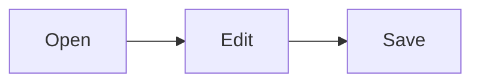

# Welcome to Ryne

This document is an editable guide to the formats currently available. Click text to edit it. Inline Markdown markers appear around the caret and fold back when you leave; hovering over a heading does not reveal its markers.

Use Ryne → Language in the top menu bar to change the interface and this untouched default guide. Once you edit or save the guide, it is your document and language changes preserve it. Opened files are preserved too.

## Paragraphs and line breaks

Enter starts a new paragraph. Shift+Enter inserts a hard line break. Long paragraphs wrap to the window width without changing the Markdown source.
This is a soft source line break in the same paragraph.  
This line follows a hard break, written as two spaces before the newline.

## Headings

The title above is H1; this section heading is H2. Type one to six `#` characters at a block start, then text. A missing separator space is added automatically. Click a heading to edit its markers; leave it to fold them again.

### H3 — Third-level heading

#### H4 — Fourth-level heading

##### H5 — Fifth-level heading

###### H6 — Sixth-level heading

Setext H1 heading
=================

Setext H2 heading
-----------------

Setext uses an underline of `=` for H1 or `-` for H2. Click to reveal and edit the underline.

## Inline formatting, links and escapes

**Bold** · *Italic* · ~~Strikethrough~~ · __Bold with underscores__ · _Italic with underscores_ · **Bold with *nested italic*** · [Example link](https://example.org).

Click an inline format or enter it with arrow keys to edit its source, including enclosing markers. After an opening marker, the first body character completes a valid closing marker; typing that closer skips over it. This also works for links, inline code and single-dollar formulas. Code and source modes keep literal input.

Inline code: `**literal text**` and ``a `backtick` inside code``. Markdown inside code is not interpreted. Escapes keep punctuation literal: \*not italic\* and \[not a link\].

Links can include a title: [Ryne](https://example.org "Ryne website"). Autolinks: <https://example.org> and <mailto:hello@example.org>.

## Lists and tasks

- Unordered item with **bold text**.
  - Nested item with a formula: $a^2 + b^2 = c^2$.
  - Another child item.
- Another top-level item.  
  A hard line break stays inside this item.

1. Ordered item.
2. Another ordered item.
   1. Nested ordered item.

- [ ] An unfinished task.
- [x] A finished task.

The unordered markers `+` and `*` also work:

+ Another unordered marker.
* And another one.

Ordered lists can start at a number other than 1:

7. First item, numbered from seven.
8. Next item.

Enter continues a nonempty item; Enter on an empty item exits one level. Tab / Shift+Tab indent or outdent the current item and its children; the first sibling cannot indent. Shift+Enter breaks a line inside the item. Click a task checkbox to toggle its state; the change supports undo and redo. You can also edit task markers in block source.

Hover or focus an item to show its three-dot menu: insert, move, indent, outdent or delete the item and its children. The type button at the upper left of a top-level list selects or copies the complete list. Alt+Enter opens the focused item menu.

## Code blocks

Backtick fences, tilde fences and four-space indentation are supported. Fences fold into a code region with a language label. Enter preserves code indentation and stays inside the block. Type an opening fence and optional language, then Enter to add its matching closing fence in one undoable edit. Edit fences and language through block source.

```rust
fn main() {
    println!("Hello, Ryne!");
}
```

~~~python
def greet(name):
    return f"Hello, {name}!"
~~~

    **literal Markdown in indented code**
    [a link is also literal](https://example.org)

- Code can also live inside a list:
  ```json
  {"editor": "Ryne", "ready": true}
  ```

Syntax highlighting supports Rust, Python, JavaScript/JSX, TypeScript/TSX, JSON and Bash, with aliases such as `rs`, `py`, `js`, `ts` and `sh`. Use the language dropdown at the upper left of fenced code to choose a common language or default `auto`. Choosing `auto` clears the fence info string; detection affects highlighting without changing source. Language changes can be undone. Other listed languages and ambiguous code keep plain styling.

## Mermaid diagrams



Leave a closed `mermaid` block to see its diagram. Click the preview or enter with arrow keys to edit the same source; Escape folds it again. Invalid, incomplete or oversized diagrams remain editable code with diagnostics.

## Inline formulas

Energy: $E = mc^2$. Fractions and indices: $\frac{a_1}{\sqrt{b}}$.

Use a single `$` on each side of one-line LaTeX. Click or navigate into a formula to edit its source; leave to see the formula. Formulas also work in lists and table cells. Display math (`$$...$$`), multiline formulas, missing glyphs and unsupported formulas remain source.

## Tables

| Left aligned | Center aligned | Right aligned |
| :--- | :---: | ---: |
| **Bold cell** | `code` | 123 |
| First line<br>Second line | Escaped pipe: a\|b | $x^2$ |
| Empty neighbor | | 456 |

Click a cell to edit. Tab / Shift+Tab move between cells; Enter moves down in the same column. Moving past the last row can append a row. Shift+Enter adds `<br>` inside a cell. Pipes typed or pasted into cells are escaped automatically.

The cell's three-dot menu changes alignment and inserts, moves or deletes rows and columns. Alt+Enter opens the focused cell menu; arrows, Enter and Escape navigate it. Use block source to edit separators. Uneven column counts stay source. Column resizing and multi-cell TSV paste are not available yet.

## Quotes, images, separators and raw text

Quotes hide `>` and show a quote icon before the text on a pale block background. Edit the body and inline formatting directly; use block source to change structural markers. Nested quotes retain indentation. Enter continues a nonempty quote; the empty new row retains its background and indentation. Enter on an empty quote row exits one level; Shift+Enter adds a hard break within the quote. Source mode keeps literal newlines. Empty quote drafts and raw text retain editable source. Standalone HTTP(S), FTP, `file:` and `data:` images show a preview; click to edit their Markdown and leave to restore the image. PNG, JPEG, the first GIF frame WebP and SVG are supported. Data URLs accept Base64 and percent encoding; local files use `file:///...` URLs. Loading failures show a broken-image icon and a red, struck-through URL, limited to 256 characters plus an ellipsis. Click to edit the complete Markdown. Images mixed with text retain editable source.

> A quote with **inline emphasis**.
>
> A second paragraph in the same quote block.
> > A nested quote.


---

Other thematic break markers such as `***` and `___` are also recognized.
***

<div>Raw HTML stays editable source.</div>

The `---` above is a separator on its own line, separated from surrounding paragraphs by blank lines. Incomplete or unsupported syntax is kept editable without discarding content.

## Source, insertion and files

Nested content shares the type button at the upper left of the outermost block. Hover over the button to edit, select or copy the whole block’s source. Cmd+Shift+B toggles block source; Cmd+Shift+M toggles full source. Escape closes menus or folds source. In source mode, input and newlines are literal.

At the end of the block type menu, choose “Add below” or “Add above”, then a block type. The first document block only offers “Add below”. Insertion undoes in one step; Escape returns from the type picker to the block menu.

Hover below the document to reveal `+` and insert any of these block types. Unclosed structures must be completed before a new block can be appended.

Cmd+O opens a file; Cmd+S saves; Cmd+Shift+S saves as. Cmd+Z / Cmd+Shift+Z undo and redo. Cmd+A/C/X/V select all, copy source, cut and paste. Selection and paste can span lines and blocks. Viewing markers, menus or source never marks the document as modified; saving preserves original source bytes and line endings. IME text is committed as one undoable edit.

Click Format in the toolbar to format the whole Markdown source in one undoable step. Rules repair missing spaces in standalone headings and task markers while preserving code contents, paragraph line breaks and container indentation. Saving never formats automatically.
