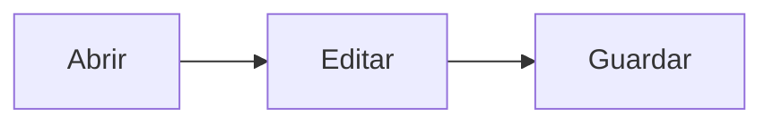

# Bienvenido a Ryne

Este documento es una guía editable de los formatos disponibles actualmente. Haz clic en el texto para editarlo. Los marcadores Markdown en línea aparecen alrededor del cursor y se pliegan al salir. Pasar el puntero sobre un encabezado no muestra sus marcadores.

El menú Ryne → Idioma de la barra de menús cambia la interfaz y esta guía predeterminada sin editar. Después de editarla o guardarla, pasa a ser tu documento y los cambios de idioma conservan su contenido, al igual que el de los archivos abiertos.

## Párrafos y saltos de línea

Intro crea un párrafo. Mayús+Intro inserta un salto de línea forzado. Los párrafos largos se ajustan al ancho de la ventana sin modificar el código Markdown.
Este es un salto en el código fuente del mismo párrafo.  
Esta línea sigue a un salto forzado, escrito con dos espacios antes del salto de línea.

## Encabezados

El título del documento es H1 y el de esta sección es H2. Escribe de uno a seis `#` al inicio de un bloque y luego el texto. Si falta el espacio separador, se añade automáticamente. Haz clic en un encabezado para editar sus marcadores; sal de él para plegarlos.

### H3 — Encabezado de tercer nivel

#### H4 — Encabezado de cuarto nivel

##### H5 — Encabezado de quinto nivel

###### H6 — Encabezado de sexto nivel

Encabezado Setext H1
=================

Encabezado Setext H2
-----------------

Setext usa una línea de `=` para H1 o de `-` para H2. Haz clic para mostrar y editar el subrayado.

## Formatos en línea, enlaces y escapes

**Negrita** · *Cursiva* · ~~Tachado~~ · __Negrita con guiones bajos__ · _Cursiva con guiones bajos_ · **Negrita con *cursiva anidada*** · [Enlace de ejemplo](https://example.org).

Haz clic en un formato o entra con las flechas para editar su código, incluidos los marcadores exteriores necesarios. Tras un marcador de apertura, el primer carácter del texto completa un cierre válido. Escribir ese mismo carácter permite saltar el cierre añadido. También funciona con enlaces, código en línea y fórmulas con un dólar. El código y los modos de código fuente mantienen la entrada literal.

Código en línea: `**texto literal**` y ``un `acento grave` dentro del código``. El Markdown dentro del código no se interpreta. La barra inversa conserva los signos literales: \*sin cursiva\* y \[sin enlace\].

Los enlaces pueden incluir un título: [Ryne](https://example.org "Sitio de Ryne"). Enlaces automáticos: <https://example.org> y <mailto:hola@example.org>.

## Listas y tareas

- Elemento sin ordenar con **negrita**.
  - Elemento anidado y fórmula: $a^2 + b^2 = c^2$.
  - Otro elemento hijo.
- Otro elemento principal.  
  El salto forzado permanece dentro de este elemento.

1. Elemento numerado.
2. Otro elemento numerado.
   1. Elemento numerado anidado.

- [ ] Una tarea pendiente.
- [x] Una tarea terminada.

Las listas sin ordenar también admiten los marcadores `+` y `*`:

+ Otro marcador de lista.
* Y otro más.

Una lista numerada puede comenzar por un número distinto de 1:

7. Primer elemento, numerado desde siete.
8. Elemento siguiente.

Intro continúa un elemento con contenido; en uno vacío sale de un nivel. Tab / Mayús+Tab aumentan o reducen la sangría del elemento y sus hijos; el primer elemento de un nivel no puede aumentar su sangría. Mayús+Intro añade un salto dentro del elemento. Haz clic en la casilla de una tarea para cambiar su estado; puedes deshacer y rehacer el cambio. También puedes editar sus marcadores en el código del bloque.

Pasa el puntero o sitúa el cursor en un elemento para mostrar su menú de tres puntos: insertar, mover, cambiar la sangría o eliminar el elemento y sus hijos. El botón de tipo de la esquina superior izquierda de una lista de primer nivel selecciona o copia toda la lista. Alt+Intro abre el menú del elemento activo.

## Bloques de código

Se admiten cercas de acentos graves, de virgulillas y código con cuatro espacios de sangría. Las cercas se pliegan en una zona de código con una etiqueta de lenguaje. Intro conserva la sangría y permanece dentro del bloque. Escribe la cerca inicial y un lenguaje opcional; Intro añade la cerca de cierre en una sola edición que se puede deshacer. Edita las cercas y el lenguaje desde el código del bloque.

```rust
fn main() {
    println!("Hello, Ryne!");
}
```

~~~python
def greet(name):
    return f"Hello, {name}!"
~~~

    **Markdown literal en código con sangría**
    [el enlace también es literal](https://example.org)

- El código también puede estar dentro de una lista:
  ```json
  {"editor": "Ryne", "ready": true}
  ```

El resaltado admite Rust, Python, JavaScript/JSX, TypeScript/TSX, JSON y Bash, con alias como `rs`, `py`, `js`, `ts` y `sh`. El menú de lenguaje en la esquina superior izquierda del código cercado ofrece lenguajes comunes y `auto` por defecto. Elegir `auto` vacía el campo de información de la cerca. La detección resalta sin modificar la fuente. Los cambios manuales se pueden deshacer. Otros lenguajes y el código ambiguo mantienen un estilo sencillo.

## Diagramas Mermaid



Sal de un bloque `mermaid` cerrado para ver el diagrama. Haz clic en la vista previa o entra con las flechas para editar el mismo código; Esc lo pliega de nuevo. Los diagramas inválidos, incompletos o demasiado grandes siguen siendo código editable con un diagnóstico.

## Fórmulas en línea

Energía: $E = mc^2$. Fracciones y subíndices: $\frac{a_1}{\sqrt{b}}$.

Coloca un solo `$` a cada lado del LaTeX de una línea. Haz clic o entra con las flechas para editar el código; sal para ver la fórmula. También funciona en listas y celdas de tabla. Las fórmulas con glifos ausentes o no compatibles conservan su código.

## Ecuaciones en bloque

Una sumatoria:

$$
\sum_{i=1}^{n} i = \frac{n(n+1)}{2}
$$

Una matriz escrita en varias líneas:

$$
\begin{pmatrix}
1 & 2 \\
3 & 4
\end{pmatrix}
$$

Rodea el LaTeX con `$$` en un párrafo independiente para mostrar una ecuación centrada. Haz clic o usa las flechas para editar todo su código. Intro después de un `$$` aislado completa el delimitador de cierre; dentro del cuerpo inserta un salto de línea. Se admiten listas, citas y exportación PDF. El modo de código conserva la entrada literal. Las ecuaciones vacías o no reconocidas y algunos entornos de alineación conservan su código.

## Tablas

| Alineado a la izquierda | Centrado | Alineado a la derecha |
| :--- | :---: | ---: |
| **Celda en negrita** | `code` | 123 |
| Primera línea<br>Segunda línea | Barra escapada: a\|b | $x^2$ |
| Vecina vacía | | 456 |

Haz clic en una celda para editarla. Tab / Mayús+Tab cambian de celda; Intro baja por la misma columna. Avanzar más allá de la última fila puede añadir otra. Mayús+Intro añade `<br>` dentro de la celda. Las barras verticales escritas o pegadas se escapan automáticamente.

El menú de tres puntos de la celda cambia la alineación e inserta, mueve o elimina filas y columnas. Alt+Intro abre el menú activo; las flechas, Intro y Esc permiten navegar. Edita los separadores desde el código del bloque. Las tablas con distinto número de columnas conservan el código. Aún no se admite ajustar el ancho de columnas ni pegar TSV en varias celdas.

## Alertas

Estos ejemplos muestran los cinco tipos de alertas. Mantén los marcadores de tipo en inglés y edita el contenido según necesites. Separa las alertas con una línea en blanco.

> [!NOTE]
> Una nota destaca información que conviene conocer incluso al leer por encima.

> [!TIP]
> Un consejo ofrece recomendaciones o trucos útiles para facilitar una tarea.

> [!IMPORTANT]
> Una alerta importante señala la información clave para alcanzar un objetivo.

> [!WARNING]
> Una advertencia requiere atención inmediata para evitar problemas.

> [!CAUTION]
> Una precaución explica los riesgos o las consecuencias negativas de una acción.

## Citas, imágenes, separadores y texto sin procesar

Las citas ocultan `>` y muestran un icono de cita delante del texto sobre un fondo claro. El contenido y los formatos en línea se editan directamente; el código del bloque permite cambiar los marcadores. Las citas anidadas conservan la sangría. Intro continúa una cita no vacía; la nueva línea conserva el fondo y la sangría. En una línea de cita vacía, Intro sale de un nivel; Mayús+Intro añade un salto de línea dentro de la cita. El modo de código fuente conserva los saltos literales. Las citas vacías y el texto sin procesar conservan código editable. Las imágenes HTTP(S), FTP, `file:` y `data:` que ocupan un párrafo muestran una vista previa: haz clic para editar su Markdown y sal para restaurar la imagen. Se admiten PNG, JPEG, el primer fotograma GIF, WebP y SVG. Las URL data admiten Base64 y codificación porcentual; los archivos locales usan `file:///...`. Si falla la carga, se muestra un icono de imagen rota seguido de la URL en rojo y tachada, limitada a 256 caracteres más puntos suspensivos. Haz clic para editar todo el Markdown. Las imágenes mezcladas con texto conservan el código.

> Una cita con **negrita en línea**.
>
> Un segundo párrafo dentro del mismo bloque de cita.
> > Una cita anidada.


---

También se reconocen otros separadores, como `***` y `___`.
***

<div>El HTML sin procesar permanece como código editable.</div>

El `---` anterior es un separador en su propia línea, rodeado de líneas vacías. La sintaxis incompleta o no compatible sigue siendo editable sin perder contenido.

## Código fuente, inserción y archivos

El contenido anidado comparte el botón de tipo de la esquina superior izquierda del bloque de primer nivel. Pasa el puntero sobre él para editar, seleccionar o copiar el código de todo el bloque. Cmd+Mayús+B alterna el código del bloque; Cmd+Mayús+M el código completo. Esc cierra los menús o pliega el código. En modo de código fuente, la entrada y los saltos son literales.

Al final del menú de tipo de bloque, elige «Añadir debajo» o «Añadir encima» y después un tipo de bloque. El primer bloque solo ofrece «Añadir debajo». La inserción se deshace en un paso; Esc vuelve del selector al menú del bloque.

Pasa el puntero debajo del documento para mostrar `+` e insertar estos tipos de bloques. Completa primero las estructuras sin cerrar antes de añadir un bloque.

Cmd+O abre un archivo; Cmd+S guarda; Cmd+Mayús+S guarda como. Cmd+Z / Cmd+Mayús+Z deshacen y rehacen. Cmd+A/C/X/V seleccionan todo, copian el código, cortan y pegan. La selección y el pegado pueden abarcar líneas y bloques. Ver marcadores, menús o código no modifica el documento; al guardar se conservan los bytes originales y los finales de línea. La confirmación del IME se aplica como una sola edición que se puede deshacer.

Pulsa Formatear en la barra de herramientas para dar formato a toda la fuente Markdown en una operación que puedes deshacer. Las reglas añaden los espacios que faltan en títulos aislados y marcadores de tareas, conservando el código, los saltos de párrafo y la sangría de los contenedores. Guardar no aplica formato automáticamente.
