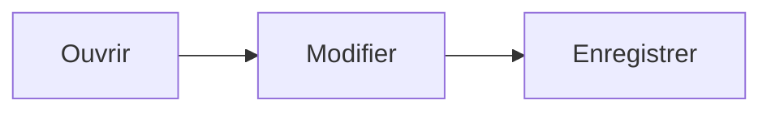

# Bienvenue dans Ryne

Ce document est un guide modifiable des formats actuellement disponibles. Cliquez sur le texte pour le modifier. Les marqueurs Markdown en ligne apparaissent autour du curseur et se replient quand il s'éloigne. Survoler un titre ne révèle pas ses marqueurs.

Le menu Ryne → Langue de la barre de menus change l'interface et ce guide par défaut encore intact. Après modification ou enregistrement, le guide devient votre document et son contenu est conservé lors des changements de langue, tout comme les fichiers ouverts.

## Paragraphes et sauts de ligne

Entrée crée un paragraphe. Maj+Entrée insère un saut de ligne forcé. Les longs paragraphes s'adaptent à la largeur de la fenêtre sans modifier la source Markdown.
Ceci est un retour à la ligne dans la source du même paragraphe.  
Cette ligne suit un saut forcé, écrit avec deux espaces avant le retour à la ligne.

## Titres

Le titre du document est de niveau H1 et celui de cette section de niveau H2. Saisissez un à six `#` au début d'un bloc, puis le texte. Un espace de séparation manquant est ajouté automatiquement. Cliquez sur un titre pour modifier ses marqueurs ; quittez-le pour les replier.

### H3 — Titre de troisième niveau

#### H4 — Titre de quatrième niveau

##### H5 — Titre de cinquième niveau

###### H6 — Titre de sixième niveau

Titre Setext H1
=================

Titre Setext H2
-----------------

Setext utilise une ligne de `=` pour H1 ou de `-` pour H2. Cliquez sur le titre pour afficher et modifier ce soulignement.

## Formats en ligne, liens et échappement

**Gras** · *Italique* · ~~Barré~~ · __Gras avec tirets bas__ · _Italique avec tirets bas_ · **Gras avec *italique imbriqué*** · [Exemple de lien](https://example.org).

Cliquez sur un format ou utilisez les flèches pour modifier sa source, y compris les marqueurs englobants nécessaires. Après un marqueur ouvrant, le premier caractère du texte complète un marqueur fermant valide. Saisir ce même caractère permet de franchir la fermeture ajoutée. Cela fonctionne aussi pour les liens, le code en ligne et les formules à un dollar. Le code et les modes source conservent la saisie littérale.

Code en ligne : `**texte littéral**` et ``un `accent grave` dans le code``. Le Markdown dans le code n'est pas interprété. La barre oblique inverse protège les signes : \*pas d'italique\* et \[pas de lien\].

Les liens peuvent avoir un titre : [Ryne](https://example.org "Site de Ryne"). Liens automatiques : <https://example.org> et <mailto:bonjour@example.org>.

## Listes et tâches

- Élément non ordonné avec du **gras**.
  - Élément imbriqué et formule : $a^2 + b^2 = c^2$.
  - Un autre sous-élément.
- Un autre élément principal.  
  Le saut forcé reste dans cet élément.

1. Élément numéroté.
2. Autre élément numéroté.
   1. Élément numéroté imbriqué.

- [ ] Une tâche à terminer.
- [x] Une tâche terminée.

Les listes non ordonnées acceptent aussi les marqueurs `+` et `*` :

+ Un autre marqueur de liste.
* Et un autre.

Une liste numérotée peut commencer par un nombre différent de 1 :

7. Premier élément, numéroté à partir de sept.
8. Élément suivant.

Entrée continue un élément non vide ; sur un élément vide, elle quitte un niveau. Tab / Maj+Tab augmentent ou réduisent le retrait de l'élément et de ses enfants ; le premier élément d'un niveau ne peut pas être décalé davantage. Maj+Entrée ajoute un saut dans l'élément. Cliquez sur la case d'une tâche pour changer son état ; vous pouvez annuler ou rétablir ce changement. Les marqueurs restent modifiables dans la source du bloc.

Survolez un élément ou placez-y le curseur pour afficher le menu à trois points : insérer, déplacer, modifier le retrait ou supprimer l'élément et ses enfants. Le bouton de type en haut à gauche d'une liste de premier niveau sélectionne ou copie toute la liste. Alt+Entrée ouvre le menu de l'élément actif.

## Blocs de code

Les clôtures d'accents graves, de tildes et l'indentation de quatre espaces sont prises en charge. Les clôtures se replient en une zone de code avec une étiquette de langage. Entrée conserve l'indentation et reste dans le bloc. Saisissez la clôture ouvrante et un langage facultatif, puis Entrée pour ajouter la fermeture ; une seule annulation rétablit l'état précédent. Modifiez les clôtures et le langage dans la source du bloc.

```rust
fn main() {
    println!("Hello, Ryne!");
}
```

~~~python
def greet(name):
    return f"Hello, {name}!"
~~~

    **Markdown littéral dans du code indenté**
    [ce lien reste aussi littéral](https://example.org)

- Le code peut aussi figurer dans une liste :
  ```json
  {"editor": "Ryne", "ready": true}
  ```

La coloration prend en charge Rust, Python, JavaScript/JSX, TypeScript/TSX, JSON et Bash, avec des alias comme `rs`, `py`, `js`, `ts` et `sh`. Le menu de langage en haut à gauche du code clôturé propose des langages courants et `auto` par défaut. Choisir `auto` vide le champ d’information de la clôture. La détection colore le code sans modifier la source. Les changements manuels sont annulables. Les autres langages et le code ambigu gardent un style simple.

## Diagrammes Mermaid



Quittez un bloc `mermaid` fermé pour afficher le diagramme. Cliquez sur l'aperçu ou entrez avec les flèches pour modifier la même source ; Échap le replie. Les diagrammes invalides, incomplets ou trop volumineux restent du code modifiable avec un diagnostic.

## Formules en ligne

Énergie : $E = mc^2$. Fractions et indices : $\frac{a_1}{\sqrt{b}}$.

Placez un seul `$` de chaque côté du LaTeX sur une ligne. Cliquez ou utilisez les flèches pour modifier la source ; quittez la formule pour la voir. Les listes et cellules de tableau les acceptent aussi. Les formules séparées (`$$...$$`), multilignes, sans glyphes disponibles ou non prises en charge restent en source.

## Tableaux

| Aligné à gauche | Centré | Aligné à droite |
| :--- | :---: | ---: |
| **Cellule en gras** | `code` | 123 |
| Première ligne<br>Deuxième ligne | Barre échappée : a\|b | $x^2$ |
| Voisine vide | | 456 |

Cliquez dans une cellule pour la modifier. Tab / Maj+Tab passent d'une cellule à l'autre ; Entrée descend dans la même colonne. Dépasser la dernière ligne peut en ajouter une. Maj+Entrée ajoute `<br>` dans la cellule. Les barres verticales saisies ou collées sont échappées automatiquement.

Le menu à trois points de la cellule change l'alignement, insère, déplace ou supprime des lignes et colonnes. Alt+Entrée ouvre le menu actif ; les flèches, Entrée et Échap le contrôlent. Modifiez les séparateurs dans la source du bloc. Les tableaux irréguliers restent en source. Le redimensionnement des colonnes et le collage TSV dans plusieurs cellules ne sont pas encore disponibles.

## Citations, images, séparateurs et texte brut

Les citations masquent `>` et affichent une icône de citation devant le texte sur un fond clair. Le contenu et les formats en ligne sont modifiables directement ; la source du bloc permet de modifier les marqueurs. Les citations imbriquées conservent leur retrait. Entrée continue une citation non vide ; la nouvelle ligne conserve le fond et le retrait. Sur une ligne de citation vide, Entrée quitte un niveau ; Maj+Entrée ajoute un saut de ligne dans la citation. Le mode source conserve les retours littéraux. Les citations vides, les images et le texte brut restent en source modifiable. Les images n'ont pas encore d'aperçu.

> Une citation avec du **gras en ligne**.
>
> Un deuxième paragraphe dans le même bloc de citation.
> > Une citation imbriquée.


---

D'autres marqueurs de séparation comme `***` et `___` sont reconnus.
***

<div>Le HTML brut reste une source modifiable.</div>

Le `---` ci-dessus est un séparateur sur sa propre ligne, entouré de lignes vides. Les syntaxes incomplètes ou non prises en charge restent modifiables sans perte de contenu.

## Source, insertion et fichiers

Le contenu imbriqué partage le bouton de type en haut à gauche du bloc de premier niveau. Survolez ce bouton pour modifier, sélectionner ou copier la source du bloc entier. Cmd+Maj+B bascule la source du bloc ; Cmd+Maj+M la source complète. Échap ferme les menus ou replie la source. En mode source, saisie et retours sont littéraux.

À la fin du menu de type de bloc, choisissez « Ajouter en dessous » ou « Ajouter au-dessus », puis un type de bloc. Le premier bloc propose uniquement « Ajouter en dessous ». Une seule annulation retire l’insertion ; Échap revient au menu du bloc.

Survolez le bas du document pour afficher `+` et insérer ces types de blocs. Complétez d'abord les structures non fermées avant d'ajouter un bloc.

Cmd+O ouvre un fichier ; Cmd+S enregistre ; Cmd+Maj+S enregistre sous. Cmd+Z / Cmd+Maj+Z annulent et rétablissent. Cmd+A/C/X/V sélectionnent tout, copient la source, coupent et collent. Sélection et collage peuvent traverser les lignes et les blocs. Afficher les marqueurs, menus ou la source ne modifie pas le document ; l'enregistrement conserve les octets source et les fins de ligne. La validation IME forme une seule modification annulable.

Cliquez sur Formater dans la barre d’outils pour formater toute la source Markdown en une opération annulable. Les règles ajoutent les espaces manquants aux titres isolés et aux marqueurs de tâches, en conservant le code, les retours de paragraphe et l’indentation des conteneurs. L’enregistrement ne formate pas automatiquement.
