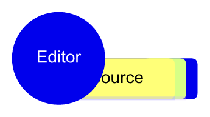
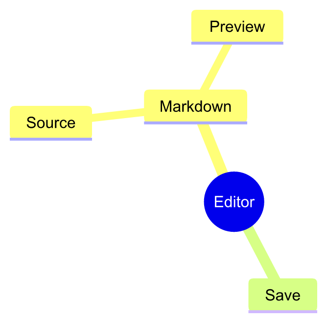

# Mermaid 原生渲染器评估

评估日期：2026-10-12。对象是 Ryne 的 Rust / GPUI 0.2.2 桌面编辑器。
本文保留最初的 0.8.0 选型实验与记录；随后已用兼容的 **Merman 0.7.0** 接入编辑器。
以下“候选对比”和“可复现实测”仍是原始独立实验，不将其结果冒充为 0.7.0 的测试。

## 当前接入

主应用锁定 `merman = 0.7.0`，仅启用 `render`，使用严格解析、语义模型检查、
resvg-safe SVG 和 `resvg 0.45.1`，转换为 GPUI 所需的 BGRA 彩色 `RenderImage`。
没有引入浏览器、Node.js、外部图表服务或第二份可编辑正文。

未采用原推荐版本 0.8.0 的原因是实际依赖冲突：Merman 0.8.0 的 core/render 要求
`unicode-segmentation ^1.13.3`，而 `editable_markdown_parser 0.0.4` 精确要求
`=1.12.0`，Cargo 无法在同一依赖图中满足它们。0.7.0 可兼容当前依赖；GPUI 0.2.2、
解析库 0.0.4、grapheme 库 1.12.0 均保留。数学渲染当时保留 RaTeX 0.1.14，
后续已独立切换为 Formulary（见 `docs/15_Formulary_Renderer_Prototype.md`），不影响此 Mermaid 依赖结论。

`src/mermaid.rs` 提取 AST 代码行、渲染并缓存结果；`src/presentation.rs` 用原子块
映射完整围栏源码；`src/editor.rs` 调度后台工作、布局、彩色绘制与进入源码的交互。
缓存只接纳同一正文的结果；源码修改、切换文档或组合输入后的布局重新使用当前解析范围。
拖选期间保留当前已折叠块，组合输入按临时源码范围映射，不提交渲染事务。

限制为单块 32 KiB、256 行、括号嵌套 32、语义 JSON 2048 个值/深度 32、标签总字节
128 KiB、SVG 2 MiB、宽高 4096、2x 栅格图 200 万像素，每文档最多尝试 32 块、
图像缓存 32 MiB、一个后台任务。取消与两秒截止检查在阶段之间进行；0.7.0 不提供
布局内部的可中断操作，所以两秒不是硬执行时间上限。

预览点击/方向键进入字面代码，Escape 返回预览；跨块选区包含原始围栏，边界删除先
展开代码。局部源码保留完整容器上下文，错误时保留代码与简短诊断。
没有二维节点编辑、缩放工具或导出 UI；图表字体使用本机系统字体。

应用接入后验证：`cargo fmt --check`、`cargo test --locked`（61 项）及
`cargo clippy --locked --all-targets -- -D warnings` 均通过。真实窗口
`--smoke-test` 覆盖彩色图像绘制、几何命中、点击与方向键展开、字面代码编辑、
IME 临时范围与撤销、跨块替换、嵌套局部源码、错误回退及 CRLF 保存；
`--smoke-test-failure` 按预期以退出码 1 正常结束。这不等同于完整人工鼠标、
键盘及各输入法候选窗口验收。已通过打包脚本更新本地 debug 应用包。

## 最初选型建议

优先采用 **merman 0.8.0 + resvg-safe SVG + 彩色图像绘制**，先交付围栏图表
预览及源码编辑。保留渲染器适配边界，不将第三方语义模型作为 Markdown 数据。

这个判断基于发布包实测：三个候选均能处理基础图表，但未闭合输入的失败行为
差异明显；mermaid-rs-renderer 的思维导图样例还有可见布局问题。
这不是完整语法兼容性排名，也没有以项目宣传的加速倍率作为选型依据。

## 候选对比

| 候选 | 核实情况 | 在本项目中的判断 |
| --- | --- | --- |
| [mermaid-rs-renderer](https://github.com/1jehuang/mermaid-rs-renderer) 0.3.1 | 发布版提供 Rust → SVG；可关闭 CLI / PNG。主分支有 `scene`，下载的 0.3.1 发布包没有该 feature | 可作替代候选；本轮暴露空白成功结果及思维导图重叠问题 |
| [merman](https://github.com/Latias94/merman) 0.8.0 | 已从 crates.io 成功解析并编译发布版；提供 `Renderer` 请求 API、`SvgPipeline::resvg_safe()`、资源策略和操作控制 | 本轮首选；仍需字体、主题、交互及复杂图的应用级验收 |
| [rusty-mermaid](https://github.com/base58ed/rusty-mermaid) 0.2.0 | 发布包有 SVG；仓库有 GPUI 后端，但发布包明确未发布 GPU 后端，也没有 `gpui` feature | 原生 Scene 路线值得保留；直接接入需要维护适配代码或 Git 依赖 |
| [cmwright/mermaid-rs](https://github.com/cmwright/mermaid-rs) | README 明确 Class 和 ER 尚未实现 | 覆盖面不符合当前优先方向；本轮未编译 |
| [官方 Mermaid / mermaid-cli](https://github.com/mermaid-js/mermaid-cli) | 官方 JS 渲染路线；CLI 依赖浏览器基础设施 | 适合作为兼容性对照；作为原生桌面的默认运行依赖成本较高 |

注意区分 `1jehuang/mermaid-rs-renderer`、其 fork 与 `cmwright/mermaid-rs`，它们不是同一个发布包。
项目主分支 README、在线文档与发布包可能不同步，依赖决策以发布包及独立 consumer 的
编译结果为准。本轮实际使用的版本及传递依赖锁定在评估程序的 Cargo.lock。

Zed 已合入 [Merman 集成 PR #57644](https://github.com/zed-industries/zed/pull/57644)，
其中提到 SVG 的 CSS、HTML 标签及 usvg/resvg 适配问题。这提供了相近技术栈的参考，
不代表 Ryne 可以省略自己的兼容性验证，也不意味着两者使用相同版本。

## 可复现实测

独立程序位于 [reviews/mermaid_renderer](reviews/mermaid_renderer)。它不属于主应用
构建，固定三个渲染库版本，使用与 GPUI 当前依赖一致的 `resvg 0.45.1`，加载本机
系统字体，输出 SVG、PNG 和 TSV。merman 关闭默认 features，显式选择七种图表家族、
SVG 和 Cytoscape；没有引入默认 ELK 或数学标签实现。

```sh
cargo run --locked --manifest-path docs/reviews/mermaid_renderer/Cargo.toml -- /tmp/ryne-mermaid-output
```

评估程序使用独立 workspace 和锁文件；主应用依赖不变。镜像缺包时可使用独立
`CARGO_HOME` 指向官方源，不修改全局 Cargo 配置。

环境：macOS、Rust 1.99.0，debug 构建。原始记录见 [results.tsv](reviews/mermaid_renderer/results.tsv)。

| 样例 | mermaid-rs-renderer 0.3.1 | rusty-mermaid 0.2.0 | merman 0.8.0 |
| --- | --- | --- | --- |
| 11 个有效样例 | 均返回 SVG，均可栅格化 | 均返回 SVG，均可栅格化 | 均返回 SVG，均可栅格化 |
| 未闭合 `A[Unclosed --> B` | 返回成功，16×16 空白图 | 返回成功，仅剩节点 A | 返回缺少 `]` 的解析错误 |
| 未知图表头 | 返回错误 | 返回错误 | 返回错误 |
| 简单思维导图目视检查 | 节点明显重叠 | 本轮未目视核验 | 本轮样例节点与文字可辨 |

有效样例包括流程图、中文标签、嵌套 subgraph、自定义颜色、时序图、类图、状态图、
ER、甘特图、思维导图及 `<br/>` 标签。共执行 39 次 source-to-SVG 调用，未出现
panic；其中 33 次有效样例的输出均被 usvg 解析并由 resvg 绘制。

“可栅格化”只验证输出管线，不证明内容完整或布局正确。已目视核验三个库的中文
流程图、merman 的嵌套子图/颜色/换行标签、两个错误输入的成功产物，以及 mmdr 和
merman 的思维导图。其余样例没有完整目视比对，也没有与官方 Mermaid 做像素对照。
本轮未测性能、峰值内存、海量节点、全语法覆盖或 GUI 交互。
独立程序的 Rust 1.99 格式检查与 Clippy `--locked --all-targets -- -D warnings`
通过；本轮未运行主应用测试、主应用 Clippy 或 GUI 冒烟检查。

两个具体输出可直接比较：

| mermaid-rs-renderer：思维导图重叠 | merman：同一份输入 |
| --- | --- |
|  |  |

这说明不能只检查第三方函数是否返回 `Ok`，就隐藏用户正在输入的代码。若采用
mermaid-rs-renderer，需要专门防止成功但遗漏内容的结果进入预览；单纯换用它的
`render_strict` 不能解决本例，因为发布版 `render` 已经经过相同的严格解析入口。

## GPUI 接入路径

已阅读本机已解析的 GPUI 0.2.2 `src/svg_renderer.rs` 与 `src/window.rs`：

- `SvgRenderer::render()` 将彩色 pixmap 转为 alpha mask；`Window::paint_svg()`
  以单色绘制它。它可以加载系统字体，但不能保持 Mermaid 节点、边和文字的不同颜色。
- 当前公式的字形路径 SVG 及 `paint_svg` 适合单色公式，不能原样复用到彩色图表。
- 采用 `resvg` 生成 pixmap，经正确的像素格式转换创建 `RenderImage`，再调用
  `Window::paint_image()` 或对应图像元素，可保持颜色。SVG 仍可保留为导出产物。

第一版建议使用第三条路径。通过 `SvgPipeline::resvg_safe()` 处理 HTML 标签与
消费者不支持的 SVG 特性，再栅格化；不要直接把浏览器用 SVG 当作 resvg 已兼容的产物。
见上游 [SVG 管线说明](https://github.com/Latias94/merman/blob/main/docs/rendering/SVG_OUTPUT_PIPELINE.md)。

在后台执行解析、布局、SVG 清理和栅格化，并限制并发任务与队列；输入更新时合并
请求，使用操作控制尽早取消旧工作。结果携带文档版本、块身份及请求编号，过期结果
不得覆盖新内容。缓存键包含源码、主题、字体、宽度/缩放及渲染器版本，缓存同时限制
条目数和字节量。Retina 按实际缩放栅格化，不把低分辨率 PNG 无限拉伸。

需要设置输入、模型、布局、SVG 输出与最终像素面积上限；第三方 panic 在工作边界
转为错误，不能穿过 AppKit 回调。`catch_unwind` 不能代替资源限制或取消机制。
外部图片、链接与 HTML 按宿主资源策略处理，预览不执行图表中的点击回调。

原生 Scene 绘制可以后续评估，在缩放、节点命中或导出需要它时引入；本轮不为此
更换 GPUI 0.2.2，也不为使用尚未发布的 feature 改用浮动 Git 依赖。

## 编辑器交互与源码约束

以下保留最初的交互规格；当前接入及实际验证范围见上文和代码中的测试：

1. 仅消费 `editable_markdown_parser` 已识别的 CodeBlock，语言标识为 `mermaid`
   且有已闭合围栏时尝试预览；反引号和波浪号均可。不要另写 Markdown 围栏扫描器。
   普通代码块、无语言缩进代码及不完整围栏保持现有编辑行为。
2. 从 `code_block::CodeBlock.rows[*].content` 提取绘图输入，排除容器前缀；渲染用
   换行可以归一化，但保存不改动原始字节、围栏、缩进或 LF / CRLF / CR。
3. 离开图表后显示预览；点击预览或键盘进入后展开代码正文，沿用代码块 Enter、
   缩进、IME 与撤销行为。局部源码入口仍包含完整容器前缀、语言字段与围栏。
4. 图表是一个派生块视图，不能成为第二份可编辑文档。跨块选区、复制、剪切和
   替换始终映射到原始源码。拖选或 IME 组合期间固定当前视图，避免切换重排。
5. 无效、超限、缺少能力或渲染失败时显示可编辑代码和简短诊断；不把错误图或
   空白图当作成功预览。纯显隐、缓存命中和后台结果应用不写事务、不产生 dirty。
6. 接入前补充围栏/容器提取、原子映射、边界导航、跨块选区、源码切换、撤销、
   换行字节保留和过期结果丢弃测试；GUI 冒烟覆盖真实几何与输入回调。

建议首次应用级验收覆盖流程图、时序图、类图、状态图、ER、甘特图与思维导图，
包括中文、长标签、子图、颜色和错误输入。新增家族逐项验证，不以库宣传的图表种类
数量替代产品支持范围。二维拖动节点编辑、图内交互和额外导出工具可后续迭代。
