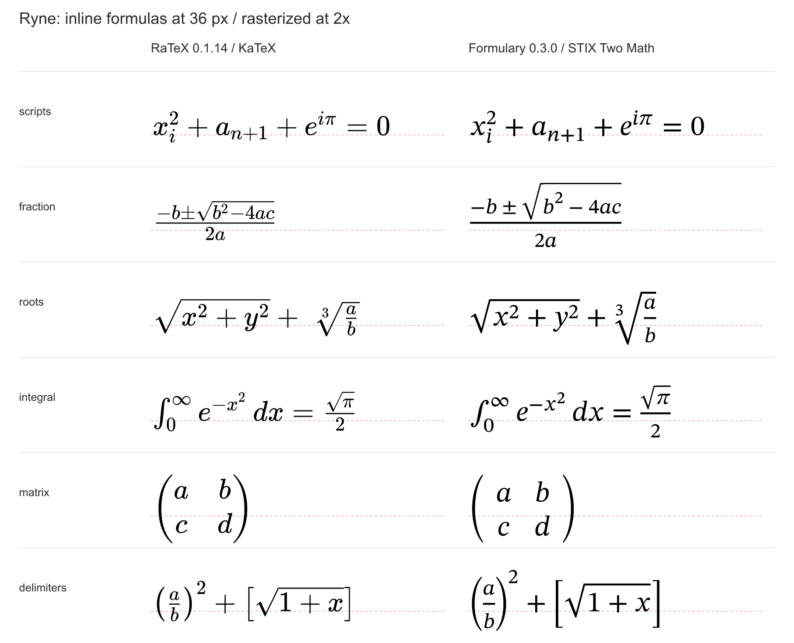

# Formulary 公式渲染对比原型

初始评估日期：2026-10-12。当时 Ryne 正式编辑器继续使用 RaTeX 0.1.14。
**后续用户要求直接替换，正式编辑器现已使用 Formulary；以下结果保留为切换前的历史对比。**
原型位于 `docs/reviews/formulary_renderer`，具有独立 Cargo 清单与锁文件，
不修改根项目依赖、源码映射、编辑事务或公式交互。

## 实验链路与复现

| 路径 | 解析与排版 | 字体与输出 |
| --- | --- | --- |
| 原方案 | RaTeX 0.1.14，Text 样式，沿用原编辑器参数 | 内嵌 KaTeX 字形路径，SVG |
| 实验方案 | math-core 0.5.5 → MathML Core → Formulary 0.3.0 | 随原型附带的 STIX Two Math 2.13 b171，SVG |

两者使用同一份 LaTeX，比较 18 px 正文与 36 px 放大，均为行内样式。
原型输出 HTML 对比页、可开关基线、宽度/上升部/下降部、MathML、1×/2× PNG、
TSV 结果及六组公式概览。命令与字体来源见
[原型说明](reviews/formulary_renderer/README.md)。

Formulary 使用字体的 OpenType MATH 度量并输出字形与规则的布局；
它接收 MathML，LaTeX 命令兼容性还受转换器影响。
参见 [Formulary 0.3.0 文档](https://docs.rs/formulary/0.3.0/formulary/)
与 [math-core 0.5.5 源码](https://docs.rs/crate/math-core/0.5.5/source/src/lib.rs)。

## 本次结果

17 个样例 × 2 个字号 × 2 个后端，共 68 项；详见
[results.tsv](reviews/formulary_renderer/results.tsv)。

| 后端 | 无警告生成 | 带警告生成 | 保留源码 |
| --- | ---: | ---: | ---: |
| RaTeX | 30 | 0 | 4 |
| Formulary | 24 | 4 | 6 |

这只是本组样例的生成结果，不是完整 LaTeX 兼容率或排版正确率。
两种后端均拒绝未知命令与未完成的分式。Formulary 额外拒绝中文样例：
STIX Two Math 缺少对应字形，原型显式检测并保留源码，避免 Formulary 跳过字形。
`\mathcal` 与含 `\mathscr` 的字体样例可生成，但转换产生的变体选择符在
当前字体没有对应 cmap 映射，可能使用同一基础字形，因此标记为警告。
颜色命令可在原型 SVG 中显示；正式编辑器仍使用单色绘制。

初步视觉检查显示两种字体风格、上下标位置与复杂公式间距存在明显差异。
Formulary 的部分分式与根号更舒展，也会明显增加行高，例如 18 px 的二次方程分式：

| 后端 | 宽度 | 上升部 + 下降部（含 padding） |
| --- | ---: | ---: |
| RaTeX | 81.008 px | 27.251 px |
| Formulary | 99.283 px | 45.529 px |

不能把更大的公式直接判定为更优。两者 padding 分别为 RaTeX 的 0.06 em 和
Formulary SVG 的固定 2 px，均计入几何。后续如接入 GPUI，需要验证行高扩展、
公式与正文的视觉比例及实际像素表现。初始结论是保留 RaTeX 与这个可复现的候选方案；
后续按用户指令完成正式切换。

## 验证与边界

- `cargo fmt --check`、`cargo check --locked --all-targets` 与原型的 7 项测试通过；
  68 项样例报告及 SVG/PNG 已实际生成，并检查了浏览器报告与概览图。
  以上 Cargo 命令均针对原型自己的 manifest，未运行根项目全套检查。
- 原型测试覆盖复杂结构的实际 SVG 栅格化、尺寸与基线指标、嵌套中文缺字、
  变体选择符、不可见运算符、未知/不完整输入、MathML 降级警告和输入/布局上限。
- HTML 源码与诊断内容转义；失败样例保留字面源码。像素分配有上限。
- 本原型不接入 GPUI，未验证编辑器内的鼠标、导航、IME、源码映射或撤销；
  不执行 GUI 冒烟测试，也不修改当前公式功能状态。
- 初始试验的 latex2mathml 0.2.3 会对部分未知命令返回含错误占位文字的成功结果，
  因而最终使用 math-core，且保持未知命令返回错误的默认配置。
- 本机 `rustc`/Cargo 为 1.99，但 `cargo clippy --version` 返回 0.1.81，
  实际以 Rust 1.81 驱动检查，低于依赖最低版本，无法完成 Clippy；未修改全局工具链。

## 正式编辑器接入

`src/math.rs` 已使用 math-core 0.5.5 → Formulary 0.3.0 与内嵌 STIX Two Math。
主应用不再依赖 RaTeX；本独立历史对比工具继续保留两种后端。
字体及许可移至 `assets/fonts/stix-two-math` 共用，macOS 包附带 OFL 和 FONTLOG。

布局先以正文参考字号 18 px 计算，再将绘制列表放大到 1000 单位/em 后生成 SVG，
避免 SVG 输出三位小数把小字号的上下标缩放系数舍入。所有尺寸还原为 em，
保留 0.06 em 内边距；编辑器原有基线、动态行高、折行、命中、选区与 IME 使用同一几何。
公式的源码范围、点击/方向键展开、缓存及撤销/保存流程沿用现有实现。

正式路径比原型严格：缺字、无对应映射的变体选择符（当前字体的部分 `\mathcal` / `\mathscr`）、
MathML 解析降级或不支持的阿拉伯语形态均保留完整可编辑源码。
保持单行、4096 字节、64 层输入嵌套及布局上限，并限制绘制项与 SVG 大小。
仍为单色呈现，未增加独立/多行公式或二维编辑。

接入验证：根项目 `cargo fmt --check`、`cargo test --locked`（88 项）、
`cargo clippy --locked --all-targets -- -D warnings` 与真实窗口 `--smoke-test` 通过。
`--smoke-test-failure` 按预期以退出码 1 正常结束，没有让 panic 穿过原生事件循环。
GUI 冒烟不是完整人工鼠标、键盘或各输入法候选窗口验收。
使用独立 Cargo 缓存中的官方源及 Rust/Clippy 1.99 工具链，未修改全局镜像或工具链。
已用 `sh scripts/bundle-macos.sh debug` 更新 `target/Ryne.app`；包内可执行文件的构建 UUID
与当前调试构建一致（签名会调整 Mach-O 字节），字体许可完整，且通过 `codesign --verify --deep --strict`。
未终止任何已有编辑窗口。
