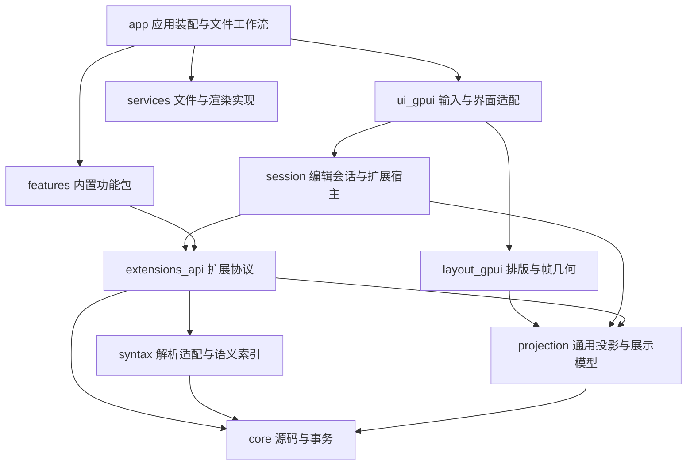

# Ryne 分层架构与插件化改进方案

日期：2026-10-13。状态：设计提案，尚未实施。

> 本方案已与插件适配架构 v1 合并为 [Ryne 分层与插件架构实施方案 v2](17_Ryne_Layered_Plugin_Architecture_v2.md)。后续架构实施以 v2 为基线，本文保留为原始设计参考。

本方案基于当前 `src/*.rs` 与 `Cargo.toml` 的代码检查。它是现有原生桌面应用的渐进重构方案；产品交互以 `AGENTS.md` 和用户最新要求为准。旧架构文档中的解析器选型、自研 Rope、crate 发布或阶段功能范围不能直接作为本次实现依据。

## 1. 建议与边界

采用**分层的模块化单体 + 内置功能插件 + 可替换的渲染服务**。

第一阶段继续交付一个原生应用，在现有 package 内建立明确的模块边界；功能插件随应用编译，由应用入口显式注册。后续按实际需要把纯内核和功能模块提取为 `publish = false` 的内部 workspace 成员。第三方进程插件属于后续独立阶段，不作为本轮重构的前提。

本轮重构要实现的具体效果：

- 添加新的代码围栏预览，不需要修改 `Document`、源码映射算法、IME 回调及主编辑器的功能分支。
- 列表、表格等结构命令可以脱离 GPUI 测试，所有修改仍提交到同一个源码事务和撤销栈。
- 替换 Formulary 或 Mermaid 渲染服务，不影响选区、保存和 Markdown 语义识别。
- 绘制、命中、选区和 IME 使用同一份带版本的帧数据；功能失败时退回可编辑源码。
- 文件读写、平台输入、功能规则、布局绘制和冒烟检查各自有明确归属。

保持当前锁定依赖，不修改或发布相邻解析库，不引入第二份可独立编辑的富文本正文。引用结构编辑仍是待完成功能；模块拆分不等于已完成引用、块拖动或表格工具栏。

## 2. 当前代码中的具体问题

统计包含同文件测试，以行数定位职责集中程度，不作为代码质量评分。

| 位置 | 当前事实 | 改进方向 |
|---|---|---|
| `src/editor.rs`，4,883 行 | 包含窗口启动、动作绑定、平台输入、导航、菜单、文件对话框、图表调度、排版、绘制和冒烟检查 | 拆成应用壳、GPUI 适配、布局、绘制、平台输入与检查驱动 |
| `src/document.rs`，2,429 行 | 前 1,067 行包含文档实现；其后主要为测试。文档同时保存源码、解析、选区、显隐、补全、结构命令和文件路径 | 分离文档内核、编辑会话、命令规划和文件服务 |
| `Document::line_break`、`insert_text` | 按表格、围栏、代码、列表、标题、行内补全逐步分支 | 建立确定的上下文解析和命令处理链 |
| `Document::display`、`highlighted_display` | 数据与事务对象主动调用投影，并认识具体高亮器 | 文档只提供快照；会话协调投影与扩展服务 |
| `src/presentation.rs`，1,573 行 | 投影认识列表、表格、公式、图表和高亮；`Display` 持有具体公式与图表类型 | 分离通用映射、语义展示模型和功能贡献 |
| `presentation::build_with_*` | 新能力通过新增参数与入口层层传递 | 使用结构化的投影输入、贡献集合和派生资源快照 |
| `src/math.rs` | 公式转换与缓存、GPUI `AssetSource`、所有块图标加载放在一起 | 拆开公式服务、资源数据和应用资源适配器 |
| `src/mermaid.rs` | 渲染结果直接包含 GPUI `RenderImage`；任务调度位于 `Editor::refresh` | 输出平台无关资源，由后台任务宿主调度、GPUI 负责上传 |
| `block`、`code_block`、`list`、`presentation` | 多处处理裸 CR 的语义兼容；消费者反复提取 AST 信息 | 收敛解析适配与容器信息，按源码版本建立语义索引 |
| `Geometry` 与输入检查 | 已检查源码快照，并比较显示文字、spans、模式防止旧几何误用 | 保留已有保护，统一为源码、投影、布局与组合输入版本键 |

已有资产应保留：解析库的 `Source`、`Transaction`、位置映射和 `Session`；统一选区和撤销；源码无损保存；列表、代码、表格语义结构；公式与图表降级策略；88 个 `#[test]` 标注和真实窗口冒烟路径。88 是静态统计，本文没有执行测试，不代表本次确认了 88 项通过。

最需要消除的是**跨职责依赖与隐式调用顺序**。仅按行数切成多个文件，会把原有耦合搬到更多文件中。

## 3. 目标分层与依赖方向

箭头表示编译依赖。`app` 是装配入口；功能包与界面适配器都是外围模块。



`features` 可以使用 `syntax` 提供的只读语义及 `services` 的纯 Rust 实现；`app` 注入具体服务。`session`、`core`、`projection` 不反向依赖具体功能包。任务执行端口位于宿主协议，GPUI 后台执行器的实现位于外围。

| 层 | 拥有的职责 | 边界约束 |
|---|---|---|
| `core` | 源码快照、强类型坐标、编辑验证、位置变换、历史记录、保存基线 | 不认识 GPUI、块类型、公式引擎、文件路径或显隐规则 |
| `syntax` | 封装解析库、裸 CR 兼容、AST 查询、块/容器/单元格索引 | 不绘制、不存界面状态、不直接提交源码修改 |
| `projection` | 源码到显示映射、投影片段、样式角色、对象与结构展示数据 | 不调用具体渲染引擎、不依赖 GPUI、不拥有编辑正文 |
| `extensions_api` | 功能声明、上下文、命令计划、展示贡献、资源与任务协议 | 不暴露可变文档、窗口、文件句柄或任意 GPUI Element |
| `session` | 统一输入意图、命令路由、事务提交、显隐、组合输入、版本与失效协调 | 依赖扩展协议，通过注册表访问功能，不硬编码各功能实现 |
| `features` | 标题、行内、列表、代码、表格、公式、Mermaid、高亮等具体规则 | 提交计划或派生数据，不持有自己的选区、IME 或撤销栈 |
| `layout_gpui` | GPUI shaping、折行、基线、结构布局、帧几何和命中 | 初期允许依赖 GPUI，避免提前重写通用文字排版引擎 |
| `ui_gpui` | 原生回调转换、绘制、焦点、菜单、滚动、光标闪烁 | 只桥接意图和呈现结果，不决定列表续项或表格转义 |
| `services` / `app` | 同目录临时保存、对话框、资源装配、具体渲染器、启动关闭流程 | 不把存储或后台结果变成另一份可编辑文档 |

解析库同时提供底层源码与语法能力。`core/text_backend.rs` 先封装现有 `Source`、事务与映射 API，`syntax/parser.rs` 封装 `ParseSnapshot`；不为实现分层重复编写文本引擎或复制完整 AST。内部功能第一阶段可通过受控只读访问器消费现有 AST，待真实需求明确后再扩展稳定语义查询接口。

裸 CR 兼容集中在解析适配器：语义视图可按现有方式做同字节宽度替换，但索引必须绑定原始 `DocumentKey`，所有正文提取、编辑及保存都访问原始源码。不能把临时规范化 `Source` 的快照 ID 当成原始文档 ID，也不能因重建语义视图丢失 dialect 或公式开关。

## 4. 建议目录及现有代码迁移

这是最终组织目标，按阶段建立目录；不要求一次创建全部文件。

```text
src/
  main.rs
  app/
    bootstrap.rs       # 内置功能注册、服务装配、应用入口
    files.rs           # 打开、保存、关闭及 dirty 工作流
    assets.rs          # 图标、字体、派生资源的 GPUI AssetSource
  core/
    document.rs        # 源码及保存基线
    text_backend.rs    # 现有解析库文本/事务 API 的封装
    position.rs        # SourceByte、DisplayByte、Utf16Offset
    transaction.rs
    history.rs
    selection.rs
  syntax/
    parser.rs
    index.rs
    containers.rs      # 完整前缀、缩进列、局部源码范围
    lines.rs           # 原始换行与行区间
  projection/
    model.rs           # ProjectionSnapshot、结构节点、资源引用
    builder.rs
    source_map.rs
    style.rs
  extensions_api/
    descriptor.rs
    command.rs
    presentation.rs
    resource.rs
  session/
    editor_session.rs
    commands.rs
    dispatch.rs
    composition.rs
    visibility.rs
    invalidation.rs
    extension_host.rs
    jobs.rs
  features/
    prose/             # 段落与标题
    inline/            # 显隐与输入补全
    lists/             # 语义适配、结构命令、呈现贡献
    code/              # 字面上下文、围栏、缩进
    tables/
    math/
    mermaid/
    highlight/
    quotes/            # 后续新增，当前不能标记为完成
  services/
    file_store.rs
    formula_renderer.rs
    diagram_renderer.rs
    syntax_highlighter.rs
  layout_gpui/
    text.rs
    inline.rs
    blocks.rs
    frame.rs
    hit_test.rs
  ui_gpui/
    view.rs
    element.rs
    paint.rs
    input_bridge.rs
    actions.rs
    menus.rs
    caret.rs
  smoke/
    runner.rs
    scenarios.rs
```

| 当前模块 | 迁移方式 |
|---|---|
| `document.rs` | 源码/历史进 `core`；选区当前值、显隐与命令协调进 `session`；文件写入进 `services`；结构编辑规则进对应 `features` |
| `input.rs` | 行内补全候选进 `features/inline`；围栏候选进 `features/code`；共享容器查询进 `syntax` |
| `block.rs` | 块范围、容器 scope 与身份进 `syntax`；类型名称与图标由功能描述提供，界面统一展示 |
| `code_block.rs`、`list.rs`、`table.rs` | 共享行/容器算法进 `syntax`，专属语义适配与编辑/展示规则进入对应功能目录 |
| `presentation.rs` | 通用片段/映射进 `projection`；类型专属规则进入功能目录；固定间距改为布局主题参数 |
| `math.rs`、`mermaid.rs`、`highlight.rs` | 功能选择与源码绑定进 `features`，具体算法进渲染/高亮服务，GPUI 资源桥接移到应用外围 |
| `theme.rs` | 语义样式参数与 GPUI 字体选择分开；插件使用角色及度量约束，界面解析实际字体颜色 |
| `insert_block.rs` | 模板和有效性规则随功能注册；统一追加位置、事务提交及菜单 UI 由宿主管理 |
| `editor.rs` | 按上方目录拆解；窗口检查用专门驱动调用原来的编辑路径，保留 `--smoke-test` 行为 |

列表编号列宽目前混在语义提取中，应最终由排版根据实际字形度量确定。此类行为改进安排在机械迁移通过验证之后，避免一次变更同时影响目录、接口和视觉结果。

## 5. 文档、会话与派生状态

### 5.1 所有权

- `Document`：拥有已提交源码、撤销/重做历史及已保存内容基线；dirty 继续按内容语义判断，不能仅比较 revision，因为撤销回已保存内容应恢复 clean。
- `EditorSession`：拥有当前源码选区、光标 affinity、显隐与局部源码会话、补全状态、临时 IME 状态、扩展宿主和投影快照。
- `FileSession`：拥有路径、打开/保存状态及异步保存请求标识；保存成功只把实际写入的快照登记为基线，期间新编辑仍为 dirty。
- `EditorView`：拥有焦点、拖选指针状态、滚动、菜单、光标闪烁任务与当前帧。
- 渲染缓存：拥有可丢弃的 SVG/像素/高亮数据，不拥有文档正文；不可变内容副本只能用于快照、保存基线或派生计算。

内核撤销记录保存事务、前后源码选区和稳定的 `HistoryEntryId`；会话按这个 ID 保存必要的补全检查点，并随历史裁剪一并释放。内核无需认识具体插件状态。插件的显隐、缓存、菜单与任务状态不进入撤销正文。提交和撤销后统一变换或重算依赖源码范围的状态，不允许插件绕过这条路径。

### 5.2 版本一致性

采用以下概念，具体类型优先复用现有 `SnapshotId`：

```text
DocumentKey    = 文档身份 + 源码 SnapshotId
ViewKey        = 显隐/源码模式版本 + CompositionId
ProjectionKey  = DocumentKey + ViewKey + 功能配置版本 + 派生资源版本
LayoutKey      = ProjectionKey + 栏宽 + 字体/主题度量版本 + scale factor
Frame          = LayoutKey + 布局结果 + 映射 + 视口/滚动变换
```

组合输入即使没有修改已提交源码，也具有独立的临时文字和投影身份。宽度与字体变化不修改源码版本；光标闪烁与单纯颜色变化不应重新 shaping。光标移动只有在显隐、原子对象展开或活动块变化影响投影时才改变投影键。

鼠标命中、上下移动、选区绘制、菜单锚点和 IME 几何统一从匹配的 `Frame` 获取。旧帧只能用于其对应快照；若版本不匹配则推迟命中或请求重排，不能把旧像素解释为新源码。拖选和预编辑时冻结不必要的显隐变化，但临时文字变化仍需产生匹配的新投影与几何。

### 5.3 坐标与输入边界

`SourceByte`、`DisplayByte`、`Utf16Offset` 分别表示 UTF-8 源码、投影文字和平台输入位置，像素位置只存在于布局与界面适配层。范围与位置映射携带所属快照身份；grapheme 是导航边界约束，不作为第四种可随意相加的字符偏移。

UTF-16 转换集中在输入桥接，且必须针对平台当前看到的文字视图：预编辑期间是组合输入覆盖后的临时文字，不是已提交源码。会话负责临时范围到源码范围的映射，确认后再生成一次修改计划。显示偏移只能经匹配投影的 `SourceMap` 进入源码坐标，不能直接传给编辑事务。

## 6. 插件模型：按能力注册

“插件”在第一版表示通过注册表接入的内置功能包；不是下载后即时执行的第三方动态库。

### 6.1 最小协议

下面是接口草图，省略辅助类型，不是已经可编译的 SDK：

```rust
trait Feature {
    fn descriptor(&self) -> FeatureDescriptor;
    fn register(&self, registry: &mut Registry) -> Result<(), RegistrationError>;
}

trait CommandHandler {
    fn plan(&self, intent: &EditIntent, ctx: &CommandContext<'_>)
        -> Result<HandlerDecision, FeatureError>;
}

trait PresentationProvider {
    fn contribute(&self, ctx: &PresentationContext<'_>)
        -> Result<Vec<PresentationContribution>, FeatureError>;
}

enum HandlerDecision {
    Pass,
    Handle(CommandPlan),
    Reject(Diagnostic),
}

enum CommandPlan {
    Edit(EditPlan),
    Select(SelectionPlan),
    View(ViewIntent),
    Consume,
}
```

功能包可以注册命令处理器、展示提供者、插入模板、块元数据、菜单命令和渲染服务请求。只实现需要的能力，不设置一个包含几十个默认空方法的总接口。`CommandContext` 提供同一版本的只读源码、语义索引、选区、上下文与输入原因；不提供 `&mut Document`。

注册发生在启动装配阶段。宿主检查功能 ID、命令 ID、依赖、冲突与协议版本，依赖排序后固定注册表；重复独占声明应返回明确诊断。第一版不支持运行中卸载，避免遗留资源引用、任务与历史状态。

`FeatureDescriptor` 记录稳定 ID、功能版本、协议版本、依赖和所声明的能力；展示贡献同时声明适用语义、字面上下文限制、进入源码策略和回退策略。注册表持有已拥有的处理器及服务句柄；只有送入后台执行的工作与数据需要相应线程安全约束，不要求所有界面侧对象跨线程。

不要引入全局可变注册表、任意 `Any` 消息总线或服务定位器。核心流程使用明确的调用及类型化结果；内部通知用于表达已提交变更和失效，不允许事件订阅者再偷偷修改正文。

### 6.2 源码修改计划

`EditPlan` 至少包含：

- 基础 `DocumentKey`，防止在另一个文档或过期快照上提交。
- 旧源码坐标下的非重叠编辑集合；相邻零宽插入必须合并或明确顺序。
- 提交后选区：使用相对于插入文本的定位，或旧锚点加 affinity 的变换规则，不能混用新旧绝对偏移。
- 撤销分组、命令来源，以及补全结束标记等必要的历史检查点更新。

提交由宿主完成：检查版本、范围、UTF-8 边界、结构范围授权与选区约束；使用现有事务 API 构建候选源码；计算位置映射和状态变换；生成匹配解析结果；最后一次发布源码、历史、选区与会话更新。任一步失败都保留原状态。解析器正常产生不完整语法节点不算提交失败。

插件规划期间不能先修改自己的持久状态再返回计划。补全、围栏自动闭合和列表子树缩进产生一个计划，进入一次撤销；选择变化及纯显隐不创建源码事务。源码模式及跨块替换必须保留修改原始结构的能力，“结构保护”只能作用于明确的正文编辑命令，不能成为全局禁止编辑隐藏前缀的规则。

### 6.3 命令分派及冲突

主界面首先把事件转为意图：`InsertText`、`Break`、`Delete`、`Indent`、`NavigateCell`、`ToggleBlockSource` 等。IME 预编辑/确认属于独立输入阶段；确认候选的 Enter 必须先被输入桥接消费，不能再次落入结构回车链。

宿主从语义索引解析最内层目标及外层容器路径，再执行确定的处理链：

1. **字面模式守卫**：全文/局部源码直接编辑字节；代码正文禁止行内自动补全和 Markdown 解释，仍允许代码换行与缩进处理。
2. **当前结构处理器**：表格单元格、代码正文、列表条目等；按最内层可编辑目标选择，外层引用和列表提供上下文。
3. **兼容的输入规则**：标题起始输入、有效行内补全、待闭合围栏；按意图和上下文适用，互斥规则由显式依赖顺序决定。
4. **普通正文回退**：段落分合、grapheme 删除或原始插入。

这是路由原则，不是把所有命令套进同一串固定顺序。迁移时分别保留 `Break`、`InsertText`、删除与导航当前已验证的顺序；例如表格输入转义后可以调用行内补全，代码输入不进入补全。

同一槽位中按范围具体程度、声明的前后依赖及固定顺序解析；无法确定的独占冲突在注册或规划阶段报错，不依赖 HashMap 遍历顺序。第一个 `Handle` 结束本次处理；`Reject` 消费意图并显示原因，不能继续回退并意外修改源码。不适用返回 `Pass`，真正错误显式报告。

跨条目、跨单元格或跨块的非空选区先走统一选区替换路径，只有声明并验证了完整选区支持的处理器才能接管。不能只看选区起点就套用单元格转义或容器续行。

### 6.4 展示贡献与嵌套组合

不能只把现有 `match` 移进插件后让各插件独立拼字符串。展示贡献应声明角色：

| 贡献 | 示例 | 组合规则 |
|---|---|---|
| 容器装饰 | 引用竖线、列表缩进 | 按 AST 祖先路径嵌套，可包裹表格或代码 |
| 结构布局 | 表格网格、代码面板、列表悬挂布局 | 同一语义节点有一个主布局拥有者 |
| 行内样式 | 强调、链接、代码、高亮 | 按来源和样式角色合并；字面区屏蔽不兼容规则 |
| 隐藏片段 | 列表前缀、有效围栏、行内标记 | 必须由已确认的语义范围支持，不可吞正文 |
| 原子替换 | 行内公式、Mermaid 图表 | 完整绑定源码范围、进入编辑策略与回退内容 |

通用展示模型先提供实际用到的组合：文字流、容器、网格、面板、行内/块级原子对象。功能通过 `ResourceId` 引用 SVG 或像素数据，通过语义样式角色表达格式。GPUI 负责解码、资源上传与绘制，不让 `Display` 持有 `math::Formula` 或 `mermaid::Diagram`。

不同功能可以共享同一个 fenced-code 语义节点：代码功能提供字面编辑和边界保护；Mermaid 提供该语言的可选预览。预览失败回到代码呈现，再失败才回到源码，不能让两个插件同时替换同一范围。

`ProjectionBuilder` 统一生成显示文字和 `SourceMap`，验证片段覆盖、UTF-8 边界、重叠规则与空编辑锚点。映射明确区分逐字片段、隐藏片段、原子对象和转换片段（如 `<br>`），不可用“源码长度等于显示长度”推断逐字映射。空表格单元格、空代码块仍要有唯一可命中的源码锚点。

失败的展示贡献整体回退，丢弃该贡献尚未发布的隐藏标记及替换对象；最终保证范围内正文没有丢失。局部源码入口使用完整容器 scope；引用中的列表、列表中的表格、单元格内公式通过组合验证，不产生独立块编辑器。

### 6.5 一个新增功能如何接入

例如未来支持另一种围栏图表语言：

1. 消费语义索引中已经确认的闭合代码块，并按语言选择目标。
2. 注册资源渲染服务及原子块预览贡献；命中后交由宿主进入原来的源码范围。
3. 注册可选的块名称、图标、菜单命令和插入模板。
4. 在 `app/bootstrap.rs` 的内置功能清单加入注册。
5. 增加契约用例：嵌套容器、无效输入、旧结果、选区与源码回退。

这个例子不需要修改 `core`、`input_bridge` 或源码映射算法。真正新增网格等布局原语时，才扩展展示协议及 GPUI 布局实现；插件化不承诺任何未知交互都能零改宿主实现。

## 7. 后台服务、资源与缓存

统一任务协议，但保持不同服务的预算与执行策略。第一步先迁移现有 Mermaid 串行任务，不要求立即把所有公式和高亮都异步化。

```text
RenderRequest = FeatureId + ServiceVersion + DocumentKey + Target + InputKey + Options
RenderResult  = RequestId + InputKey + Resource / Diagnostic
```

- `InputKey` 必须覆盖实际影响结果的输入：正文、语言、引擎配置及版本；字体、主题或分辨率只有在影响产物时进入键。
- 相同输入可去重和复用资源，但源码范围不能作为跨修订的永久身份。当前块用修订内节点句柄定位；后台资源按内容关联到当前快照重新解析出的目标。
- 结果回到 UI 时检查文档身份、请求代次、目标仍存在及当前输入一致。旧结果可以进入内容缓存，但不能直接把旧范围挂到当前投影；编辑后回到相同内容也需重新绑定目标。
- 调度器负责取消、队列上限、去重和并发；服务负责字节、行数、复杂度及产物尺寸限制。失败缓存应区分确定性输入错误与取消/暂时故障。
- 缓存按条数和总字节计费并逐步淘汰；保留当前 Mermaid 32 MiB 等限制。公式现有 256 项整表清空策略可后续改为有字节预算的淘汰，避免一次清空引发集中重算。
- 渲染器输出 `SvgBytes + Metrics` 或 `RgbaPixels + Dimensions` 等平台无关数据。GPUI 资源适配器在界面侧创建对应资源，并管理释放与错误回退。

Merman 0.7.0 的取消与两秒截止检查只能位于处理阶段之间，不能中断其布局内部；抽出任务宿主不会自动消除这个限制。若以后要求硬超时或第三方执行隔离，另行采用可终止的工作进程。

## 8. 插件化的实施范围

| 形式 | 本轮取舍 | 适用范围 |
|---|---|---|
| 内置 Rust 功能包 | 本轮实现目标 | 标题、行内、列表、代码、表格及附加呈现能力，应用入口统一装配 |
| 可替换服务实现 | 本轮建立边界，按需要替换 | 公式引擎、图表渲染、高亮、文件存储实现 |
| 编译期开关 | 边界稳定后按实际需求增加 | 内部测试、可选渲染引擎；正式版本仍默认包含已承诺的功能 |
| 第三方进程插件 | 后续独立设计 | 纯计算、围栏预览、导出等有清晰输入输出的扩展 |
| 运行中原生动态库加载、任意 GPUI 插件组件 | 本轮不实现 | 尚无必要的生命周期、二进制兼容与故障隔离设计 |

第三方扩展未来复用相同逻辑协议，通过版本化消息传输快照切片、资源和修改提案，不传递 Rust 内存对象。需要额外定义能力授权、请求大小、超时、版本协商、生命周期和宿主验证；这些属于第三方插件阶段，不增加到当前编辑工作流。

禁用附加呈现插件时保留可编辑源码；正式版本中的 Mermaid、公式、表格等既有能力仍按需求验收。底层原始编辑、统一选区、IME、撤销和保存是宿主基础设施，不能被插件移除。内置插件共享进程，不具备安全隔离：返回错误时可降级，必要的渲染边界可继续捕获可展开 panic，但不能声称能恢复任意崩溃或中断阻塞调用。

## 9. 渐进迁移顺序与验收

每个阶段形成可独立审查的变更；同一阶段可分成若干小提交。先冻结行为，再迁移职责，最后做性能与体验改进。

| 阶段 | 工作内容 | 完成条件 |
|---|---|---|
| P0 行为基线 | 记录已有命令顺序、典型输入输出与现有检查结果；整理关键回归语料 | 有源码字节、选区、撤销结果与关键几何基线；未完成引用明确标注 |
| P1 外围拆分 | 提取冒烟场景、图标/字体资源、文件写入及工作流、布局/绘制/输入桥接；保留旧 facade | 现有启动和检查入口不变，读写失败/关闭 dirty 文档语义不变；纯搬迁不夹带新功能 |
| P2 内核与会话 | 拆开文档、选区/显隐、IME 临时状态；集中事务提交、坐标类型和版本键 | `core` 不依赖投影、高亮或 GPUI；只有统一提交口可更新已提交正文 |
| P3 语义及投影契约 | 收敛裸 CR 兼容、行/容器索引；拆开映射与具体资源；建立可组合展示模型 | 语义提取按快照复用，源码映射通过现有回归及空锚点/原子对象测试 |
| P4 服务扩展试点 | 首先迁移 Mermaid，再迁移公式、高亮；抽出任务宿主和资源适配 | 换渲染实现不改文档；主界面不再扫描具体 `mermaid` 语言或调度专属任务；失效与回退可验证 |
| P5 结构命令插件 | 先以代码功能验证字面守卫，再迁移列表、表格，最后收敛段落/标题/行内规则与插入模板 | 新增处理器只需注册；各命令顺序、嵌套上下文、统一选区与一次撤销保持一致 |
| P6 扩展证明 | 用尚未完成的引用功能验证容器组合与命令接口，独立交付功能变更 | 引用竖线、非空续行、空层退出、嵌套前缀通过验收；若需要侵入内核，先调整抽象 |
| P7 按需加强边界 | 将纯内核/协议/功能移到私有 workspace 包；有第三方需求再设计进程协议 | 构建依赖能阻止反向引用；无需发布 crate 或引入插件商店 |

P0–P5 是架构改进主体。P6 是明确区分的后续功能交付，也用于检验扩展性；P7 按实际需要推进。无需等到第三方插件体系建成才继续产品迭代。

迁移期间允许临时兼容 facade，但每个 facade 应标注删除阶段和唯一调用方向；不同时保留两套可写文档或新旧命令引擎。双跑比较只能在测试中基于独立快照执行。

## 10. 验证、回归与架构约束

不以“拆出多少文件”或“trait 数量”验收，使用真实行为与依赖边界：

1. **内核契约**：无修改不 dirty；多处编辑一次撤销；撤销回保存基线为 clean；失败提交不留下部分状态；LF/CRLF/CR、中文、emoji 与组合字符范围正确。
2. **命令契约**：列表续项/退出层级/子树缩进，代码围栏闭合/字面粘贴/边界删除，表格导航/末行追加/转义/`<br>`，标题点击及输入、行内补全保持既有结果。
3. **交叉语料**：引用中的列表、列表中的代码/表格、表格内公式、跨块替换、未闭合围栏与列数不齐的表格；插件冲突不得吞正文。
4. **投影契约**：逐字片段按合法边界往返；隐藏与原子片段按 affinity 和编辑入口映射；空锚点可命中；不要求隐藏区间形成不可能的严格双射。
5. **组合输入与帧**：预编辑不提交历史；确认只提交一次；确认 Enter 不再续项；新投影不能使用旧几何；拖选/闪烁不意外改变折行。
6. **后台契约**：修改、删除目标、切换文件和相同内容重现时，旧结果不得误绑定；取消、超限、渲染失败保持可编辑代码；缓存释放后资源引用有效。
7. **存储契约**：原始字节、缩进与换行保留；临时写入/重命名失败不误标 clean；将来异步保存时只登记实际写入的快照。
8. **扩展性验收**：同类围栏预览只增加功能/服务及注册；结构命令不导入 GPUI；`core` 不导入 `features`、`projection` 或界面层；生产代码中的具体图表库仅出现在对应服务实现。

先迁移已有测试，补充新边界造成的实际风险用例，不为每个转发函数增加镜像测试。模块阶段可用受控可见性和依赖扫描约束方向，私有 workspace 阶段再用 Cargo 依赖强化；扫描不是完整的架构证明。

涉及代码的阶段按影响执行并记录：

```sh
cargo fmt --check
cargo test --locked
cargo clippy --locked --all-targets -- -D warnings
cargo run --locked -- --smoke-test
cargo run --locked -- --smoke-test-failure
```

最后一项预期退出码为 1。GUI 冒烟检查使用真实窗口几何调用回调，不替代人工鼠标键盘和各输入法候选窗口验收；检查失败不得让 panic 穿过 AppKit 事件循环。验证不得关闭可能含未保存内容的用户窗口。

本文只新增设计文档，没有修改运行代码或依赖，也没有执行编译、单元测试和 GUI 检查。实际实施后再同步 `AGENTS.md` 的模块说明及两份 README 的可用功能，不能把设计状态写成已完成能力。
