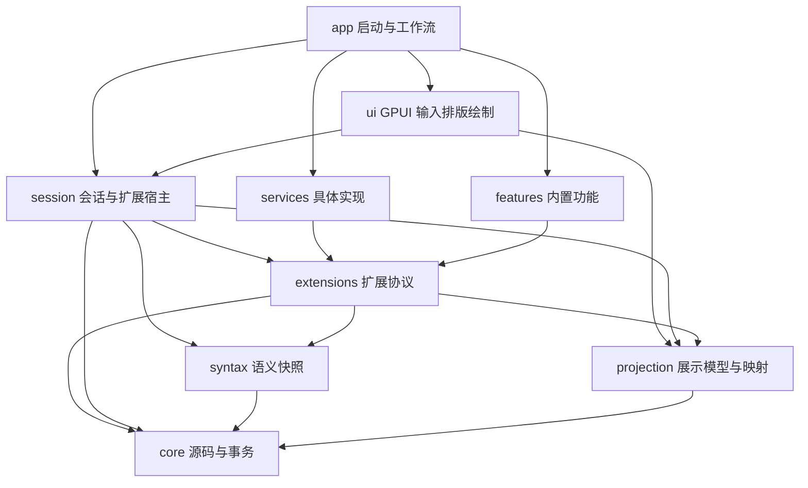

# Ryne 分层与插件架构实施方案 v2

日期：2026-10-13。状态：设计基线；本轮实施结果见 [实施记录](18_Ryne_Architecture_Implementation.md)。

实施覆盖说明：按用户要求，本轮直接采用私有 workspace，全部包加 `ryne-` 前缀；应用包为 `ryne-app`，可执行文件保持 `ryne`。下文的单 package 近期策略保留为原始设计背景，以实施记录和代码为当前组织方式。

本文综合[分层改进方案](16_Layered_Architecture_And_Extensibility_Plan.md)和[插件适配架构 v1](GPUI_GFM_Plugin_Adapter_Architecture_v1.md)，吸收代码对照评审结论，统一近期范围、接口边界与迁移顺序。两份原文保留为设计参考；后续架构实施以本文为基线。产品行为始终以 `AGENTS.md` 及用户最新明确要求为准。

## 1. 架构决策与近期范围

采用 **分层模块化单体 + 静态内置功能插件 + 类型化服务适配 + 声明式 UI 贡献**。

近期仍是一个 `publish = false` 的 Rust package 和一个原生桌面应用。先通过模块、受控可见性和单向依赖建立边界；功能随应用编译，在启动时注册。模块分离稳定后，按需要提取私有 workspace 包。

| 近期必须完成 | 保留现有实现 | 未来按条件演进 |
|---|---|---|
| 文档内核、会话、语义、投影、GPUI 职责分离 | 解析库 `Source/Transaction/Session` 与位置映射 | 实测证明必要后再评估 Rope 或解析器替换 |
| 统一命令计划、事务提交与非编辑结果 | GPUI 0.2.2 的 shaping、折行与真实几何 | 共享测量及映射协议下增加 Balanced 断行 |
| 结构功能注册、嵌套展示贡献 | Formulary 的自包含 SVG 与当前数学节点 API | 有明确收益时评估 MathDrawList 绘制 |
| 图表任务宿主、资源与缓存边界 | Mermaid 串行渲染及已有资源限制 | 需要硬截止或第三方执行时采用工作进程 |
| 块角标、菜单、插入模板声明 | 现有字体、居中内容栏和交互约定 | 新 UI 类型按真实功能需要扩展协议 |
| 类型化提交后通知及诊断 | 单窗口、单文件、无损保存工作流 | 有用户需求后设计第三方进程插件协议 |

依赖继续锁定当前版本，包括 GPUI `0.2.2`、`editable_markdown_parser 0.0.4`、Formulary `0.3.0` 和 Merman `0.7.0`。本轮不要求替换算法、引入插件市场或实现运行中卸载。

最终收益应能用具体变更验证：新增同类围栏预览只增加功能、服务和注册；结构命令可脱离 GPUI 测试；更换渲染实现不改文档事务；主编辑器不再逐项认识公式、图表和列表输入细节。

## 2. 保留的产品与数据契约

1. 原始 Markdown 是唯一可编辑正文；投影、资源、语义索引和布局均可重建。不可变快照、保存基线和后台输入副本不构成另一份编辑正文。
2. 所有内容修改通过统一源码事务；全篇只有一套当前选区、IME 状态与撤销/重做历史。块和单元格不建立独立编辑器。
3. 显隐、源码模式、悬停、折行和闪烁不改源码、不 dirty、不创建内容撤销记录。
4. UTF-8 源码、UTF-8 投影、UTF-16 平台范围和像素位置严格分离；光标导航遵循 grapheme 边界。
5. 标题点击展开、离开收起、悬停不展开；标题输入、行内补全、自动结束标记越过保持现有约定。
6. 代码内容按字面编辑；列表、表格、代码正文获得光标时维持结构呈现，内部行内语法遵循各自规则。局部源码保留完整容器上下文。
7. IME 预编辑只更新临时视图；确认文字与必要补全合成一次事务；确认候选的 Enter 不能同时续项或换行。
8. 不完整、未支持、渲染失败或超限内容保留可编辑源码。校验器不能以 Markdown 暂时不完整为由拒绝普通输入。
9. 保存保留原始字节、缩进和 LF/CRLF/CR，沿用同目录临时文件与重命名；撤销回已保存内容时恢复 clean。
10. 重构不宣称完成引用结构编辑、块拖动、表格工具栏等未完成能力；新增功能单独验收。

## 3. 分层、依赖与初始模块

箭头表示编译依赖。`extensions` 只定义协议与注册数据，运行中的调度归 `session`。



`app` 通过构造参数向功能包注入具体服务，再将功能注册到宿主；`core`、`session` 和 `projection` 不导入具体功能包或渲染器。服务协议按实际边界定义在 `extensions` 或对应核心端口中，`services` 实现这些协议。`ui` 中的排版允许依赖 GPUI，不提前抽象完整的跨平台文字引擎。

| 模块 | 职责 | 初始组织方式 |
|---|---|---|
| `core` | 源码、快照身份、事务验证、位置变换、历史、保存基线 | `document.rs`、`transaction.rs`、`position.rs` |
| `syntax` | 解析适配、行与容器、块/条目/单元格语义索引 | `parser.rs`、`index.rs`、`containers.rs` |
| `projection` | 片段、样式角色、结构模型、资源引用、源码映射 | `model.rs`、`builder.rs`、`source_map.rs` |
| `extensions` | 功能描述、命令/输入规则、展示/UI/资源协议 | 先建立 `mod.rs`、`command.rs`、`presentation.rs` |
| `session` | 当前选区、显隐、IME、命令路由、原子发布、任务与通知 | `mod.rs`、`dispatch.rs`、`composition.rs`、`jobs.rs` |
| `features` | 代码、列表、表格、标题、行内、公式、图表、高亮等规则 | 随功能迁移建立对应模块 |
| `services` | 文件写入、Formulary、Merman、Tree-sitter 实现 | 每个已接入实现一个模块 |
| `ui` | GPUI 输入桥接、布局/命中、绘制、菜单、光标与资源上传 | `view.rs`、`input.rs`、`layout.rs`、`paint.rs` |
| `app` | 启动装配、路径与文件工作流、打开/关闭提示 | `bootstrap.rs`、`files.rs` |
| `smoke` | 真实窗口检查驱动及场景 | `mod.rs`、`scenarios.rs` |

这是职责落点，不是第一天必须创建的文件清单。小模块可先使用单文件，职责或变更频率需要时再拆目录。保留现有 `main.rs` 和用户启动方式；不公开发布 SDK。

### 3.1 当前代码迁移表

| 当前代码 | 目标职责 |
|---|---|
| `document.rs` 的 `source/apply_edits/undo/saved` | `core`；移除投影、具体功能和文件路径依赖 |
| `document.rs` 的选区、reveal、block_source、补全状态 | `session`，按事务映射与历史条目协调 |
| `line_break/insert_text/indent_list/navigate_table` 等 | 对应 `features` 的命令或输入规则，统一提交口在 `session` |
| `block/code_block/list/table` 的共享范围与前缀逻辑 | `syntax`；类型专属行为与展示进对应功能 |
| `presentation.rs` | 通用模型与映射进 `projection`，语义规则进功能包 |
| `math/mermaid/highlight` | 语义绑定进功能，算法进服务，GPUI 资源桥接进 `ui` |
| `input.rs`、`insert_block.rs` | 输入候选与模板随功能迁移；共享前缀查询进 `syntax` |
| `editor.rs` | 分拆到 `session/ui/app/smoke`；消除具体功能调度分支 |
| `theme.rs` | 保留语义样式参数；GPUI 字体选择与实际资源解析放在 `ui` |

解析库已经提供文本、事务和映射能力，先包装现有 API。语义适配允许受控只读消费现有 AST，不复制完整语法树或重新扫描一套 Markdown。裸 CR 兼容集中处理，保留 dialect、公式开关和原始源码身份；同宽规范化只用于语义视图，正文提取和保存访问原始字节。

## 4. 所有权与一致性边界

| 对象 | 拥有状态 |
|---|---|
| `DocumentCore` | 已提交 `Source`、撤销/重做、`HistoryEntryId`、已保存内容基线 |
| `EditorSession` | core、匹配源码的语义快照、当前源码选区、affinity、显隐、局部源码、补全检查点、composition、扩展宿主、投影 |
| `FileSession` | 文件路径、打开/保存/关闭请求及状态；由应用工作流管理 |
| `EditorView` | 焦点、拖选指针状态、滚动、菜单、闪烁任务与当前帧 |
| `ResourceStore` / `JobHost` | 派生数据、任务请求、取消控制、缓存预算；不持有可变文档引用 |

历史条目保留事务和前后源码选区；现有自动闭合标记的恢复信息由会话按 `HistoryEntryId` 保存并随历史裁剪清理。第一版只抽取当前需要的补全检查点，不建立通用插件状态序列化系统。源码修改、历史、选区、检查点与范围变换由同一次提交协调，插件不能先更新自身状态再请求提交。

`SourceByte`、`DisplayByte`、`Utf16Offset` 是不同类型。源码范围携带 `DocumentKey`，投影范围携带 `ProjectionKey`，不能将裸 `usize` 跨接口传递。`DocumentKey` 由文档身份及现有 `SnapshotId` 组成，禁止仅凭一个递增数字跨文档接受计划。

### 4.1 语义与帧版本

```text
SemanticKey   = DocumentKey + ParserGeneration + Dialect/MathOptions
ViewKey       = 显隐/局部及全文模式版本 + CompositionId
ProjectionKey = SemanticKey + ViewKey + 功能配置/相关资源版本
LayoutKey     = ProjectionKey + 可用栏宽 + 字体/度量主题版本 + scale factor
Frame         = LayoutKey + 布局/映射 + 视口与滚动变换
```

近期保持解析同步更新：提交候选源码时生成匹配语义，再发布新会话快照。结构命令只能读取匹配当前源码的语义；旧 AST 不得用于下一次输入判断。投影与绘制可在后续 GPUI 周期更新，但旧帧不允许命中新源码。将来异步解析必须增加准备状态和同步补齐/推迟策略后再启用。

预编辑的临时文字有独立 `CompositionId` 和临时语义身份，即使已提交源码不变也不能沿用旧几何。UTF-16 转换针对平台当前看到的临时文字，由会话映射回源码范围。绘制、鼠标、导航、选区、菜单锚点与 IME 共用匹配的 `Frame`。

拖选和预编辑期间冻结非必要显隐，不冻结真实文字变化。闪烁只重绘；颜色变化不应重做 shaping；宽度、字体或对象度量变化使布局失效。源码滚动锚点沿用现有策略，模式切换不增加撤销记录。

## 5. 扩展机制与最小宿主

### 5.1 机制分工

| 机制 | 输入与产出 | 执行约束 |
|---|---|---|
| Command Handler | 编辑意图 → 编辑/选择/视图/消费计划 | 同步只读规划；独占处理者明确 |
| Input Rule | 输入草稿 → 更新草稿或非编辑结果 | 仅适用输入上下文，不能提交文档 |
| Validator | 最终计划 → 通过或拒绝 | 所有适用验证器均运行，不能改计划 |
| Presentation Provider | 语义与视图上下文 → 展示贡献 | 不调用窗口，不修改正文 |
| UI Provider | 块/会话上下文 → 角标、菜单、模板元数据 | 宿主定位绘制，只发送命令 |
| Service Adapter | 不可变输入 → 资源/高亮/存储结果 | 明确线程、预算和失败契约 |
| Observer | 已完成的状态变化 → 通知处理 | 不参与当前事务，不同步重入 |

插件是注册与组合单元；适配器是算法或服务替换边界。一个功能包只注册需要的能力，不实现几十个默认空方法。

以下为接口草图，省略辅助类型，尚非可编译 SDK：

```rust
trait BuiltinFeature {
    fn manifest(&self) -> FeatureManifest;
    fn register(&self, registrar: &mut Registrar) -> Result<(), RegistrationError>;
}

trait CommandHandler {
    fn plan(&self, intent: &EditIntent, ctx: &CommandContext<'_>)
        -> Result<Decision, FeatureError>;
}

enum Decision {
    Pass,
    Handle(CommandPlan),
    Reject(Diagnostic),
}

enum CommandPlan {
    Edit(EditPlan),
    Select(SelectionPlan),
    View(ViewIntent),
    Consume,
}
```

`Select` 用于越过自动结束标记或单元格导航，`View` 用于显隐与源码入口，`Consume` 用于已经处理的输入；这些结果不创建内容事务。只有送入工作线程的数据与服务句柄需要对应 `Send/Sync` 约束，不要求 UI 侧所有提供者跨线程。

### 5.2 注册、依赖与冲突

Manifest 记录稳定功能 ID、功能版本、内部 API 版本、所需功能和能力。注册器提供 `command/input_rule/validator/presentation/ui/insert_template/renderer` 等类型化入口，避免任意 `Any` 消息或全局可变服务定位器。

启动先校验依赖图，再分批构建注册表；注册失败回滚该功能尚未发布的贡献。缺失依赖、重复 ID、循环依赖、不兼容版本和无法解析的独占冲突必须诊断。核心编辑能力初始化失败时报告并正常退出；可选呈现失败可禁用该呈现并保留源码，其依赖者也必须重新校验，不能保持依赖缺失的激活状态。

排序先考虑语义目标、处理槽位和显式 `before/after` 约束，再使用槽位内优先级及 ID 做稳定排序。字母顺序只能保证确定性，不能用来决定两个不兼容结构处理器谁正确。同一语义节点只有一个主编辑/布局拥有者；装饰贡献可组合。

首版只在启动注册、关闭清理。注册资源由注册表持有并随其释放；不开放运行中 `deactivate`。关闭文档时使请求代次失效并取消任务；残留工作结果只可丢弃或进入允许复用的缓存，不能回写已关闭会话。静态插件在同一进程，注册能力声明不等于安全隔离。

## 6. 命令与输入的确定性处理

### 6.1 路由顺序

1. 平台输入桥接处理 IME 预编辑、确认及确认 Enter；尚未确认的文字不进入正文命令链。
2. 获取当前源码和匹配语义，解析完整容器路径、最内层目标、选区覆盖范围及字面模式。
3. `Undo/Redo` 直接走历史路径；保存等应用命令转交工作流；这些路径不运行输入补全。
4. 全文/局部源码按原始文字处理。代码正文采用字面输入配置，但保留代码换行、缩进及边界保护。
5. 跨块/跨单元格选择先进入统一替换路径；只有明确支持完整选区的规则才能接管，不能只根据起点应用单元格转义或列表前缀。
6. 其余命令按最内层结构分派；输入规则按该上下文允许的阶段执行；普通正文提供最终回退。

`Pass` 表示不适用，`Reject` 表示消费并说明原因，`Handle` 结束当前独占槽位。明确失败的结构命令不能悄悄回退为可能破坏围栏或表格的原始输入。可选智能补全失败则退回已经完成必要规范化的输入。

### 6.2 解决多阶段输入的坐标与合成问题

首版不允许多个 Hook 分别返回最终 `EditPlan` 再串联执行。普通插入使用宿主维护的 `InputDraft`：

```text
InputDraft = 原始 DocumentKey + 原始替换范围
           + 待插入文字 + 插入文字内光标 + 补全标记注释 + 输入来源

确定上下文 → NormalizeDraft → CompleteDraft → BuildPlan → ValidateAll → CommitOnce
```

- 规范化与补全只更新待插入文字及其内部坐标；原始文档范围和基础版本保持不变。每阶段对同一独占槽位只接受一个处理结果。
- 表格先处理管道转义与 `<br>`，再在允许的字面边界之外判断行内补全；代码跳过行内规则。标题分隔空格与首个正文字符进入同一个草稿。
- 需要确认 Markdown 配对时，用原始快照加草稿构造只读候选解析；候选坐标仅供判断，最终仍转换成原始范围加待插入文字。
- 阶段修改文字时同时更新草稿内光标与标记注释；不接受阶段遗留的旧内部偏移。
- Enter 续项、子树缩进、表格追加行等结构命令直接生成多编辑计划；不强行套入单范围文字草稿。
- 如未来确需任意候选源码上的计划叠加，再单独设计候选到基础坐标的组合器；没有真实用例前不引入通用变换框架。

### 6.3 最终计划与原子发布

```text
EditPlan = DocumentKey + [SourceEdit] + PlannedSelection
         + UndoGroupPolicy + Origin + CompletionCheckpointUpdate

SourceEdit = EditId + 旧源码范围 + replacement
PlannedPosition = 旧源码锚点及 affinity | EditId 内的插入偏移
```

所有编辑使用同一个旧快照，范围非重叠；相同位置的插入应合并为一项或在构建器中明确顺序。宿主先验证版本、UTF-8 边界、范围和结果选区，再运行所有适用验证器；结构命令验证其预期目标与容器，普通输入不要求得到完整有效 Markdown。

提交步骤为：使用现有 API 生成候选 `Source` 和逆事务 → 准备位置映射、选区、补全与显隐会话变换 → 生成匹配语义 → 一次发布源码、历史与会话状态 → 发布通知。发布前失败保持原状态。Undo/Redo 同样经过一致性协调，恢复必要检查点但不重新触发自动补全。

同一次输入中的正文、分隔空格、结束标记或围栏补全只形成一次撤销。第一阶段保持当前用户动作的历史边界，不借重构改为新的连续打字合并策略。

## 7. 结构展示协议与源码映射

展示模型采用当前功能所需的有限原语：`TextFlow`、`Container`、`ListRow`、`Grid`、`CodePanel`、`InlineObject`、`BlockObject`。具体功能负责语义贡献；GPUI 宿主实现这些原语的布局和绘制。新增交互形态可以扩展协议，不承诺任何未知组件都零改宿主。

| 贡献角色 | 组合方式 | 当前例子 |
|---|---|---|
| 容器 | 按 AST 祖先路径嵌套，保留 scope/prefix | 引用竖线、列表层级 |
| 主结构 | 每节点一个拥有者 | 表格网格、代码面板、列表行 |
| 行内格式/高亮 | 按角色与上下文合并 | 粗体、代码、链接、语法颜色 |
| 隐藏片段 | 必须由确认的语义标记支持 | 围栏、列表前缀、行内标记 |
| 原子替换 | 完整绑定源码范围、编辑入口和回退 | 公式、Mermaid 预览 |

代码功能拥有 fenced-code 的字面编辑；Mermaid 在满足条件时贡献可选图表替换。图表失败退回代码，代码结构无法确认时退回源码，不能同时发布重叠替换。引用中的列表、列表中的表格及单元格内公式通过容器、主结构和行内贡献组合。

`ProjectionBuilder` 统一生成显示内容和映射，检查覆盖、重叠、边界及空锚点。映射区分逐字、隐藏、原子和转换片段，例如 `<br>`；不能用字节长度相等推断逐字映射。隐藏片段按 affinity 映射，原子对象进入编辑时恢复原始范围；空单元格与空代码必须保留可命中锚点。

展示贡献使用平台无关度量和 `ResourceId`，不持有 `math::Formula`、`mermaid::Diagram` 或 GPUI 图片。验证或渲染失败时，将该贡献的隐藏与替换整体撤回，再发布原文回退，避免资源消失后正文也被隐藏。

局部源码范围来自语义索引的完整容器 scope。统一选区替换始终作用于源码，不从拼接后的显示文字反推要保存的 Markdown。

## 8. 声明式 UI 扩展

初始协议提供 `BlockMetadata`、`AdornmentSpec`、`MenuItemSpec` 和 `InsertTemplate`。功能声明图标资源、名称、命令 ID、分组/顺序及只读可用性条件；宿主管理几何、焦点、悬停、关闭和键盘操作，不接受任意 GPUI View。

- 展示目标块左上角最多一个类型标识；最内层目标及完整 scope 由语义索引确定，宿主处理槽位冲突。
- 保持焦点/悬停时显现、拖选/预编辑/全文源码时隐藏的现有约定。角标悬停不等于标题展开。
- 块源码、选块、复制源码等共用宿主命令；类型元数据由功能提供，菜单实现不逐项识别 Markdown 语法。
- 文末添加区是虚拟交互/布局节点，不写入源码或 AST。菜单可悬停展开，选定模板后才创建事务。
- 模板声明正文范围、占位选区和需要的上下文；宿主统一定位追加位置、换行约定与事务，并检查未闭合结构是否吞入新块。
- 菜单与插入命令携带文档/块身份；点击时再次校验，不能使用打开菜单时遗留的裸范围。

当前尚未完善的辅助功能可继续演进，但声明协议应保留名称与命令语义；本轮不声称完成全面无障碍验收。

## 9. 服务、后台任务和资源

首批服务是现有 `FormulaRenderer`、`DiagramRenderer`、`SyntaxHighlighter`、`FileStore`；由构造注入绑定实现。暂不建立任意按名称查找所有应用对象的服务注册中心。

| 服务 | 首个实现与结果 | 线程策略 |
|---|---|---|
| 公式 | math-core → Formulary → SVG 与 em 度量 | 先保留现有调用方式，耗时测量后再决定异步化 |
| 图表 | Merman → 像素资源与尺寸/诊断 | 迁移现有串行后台任务，保留限制 |
| 高亮 | Tree-sitter → 相对代码正文的样式范围 | 先保留缓存策略，绑定当前语义范围 |
| 文件 | 原始快照 → 同目录临时写入及重命名回执 | IO 移出原生输入热路径；文件工作流阶段接入后台执行 |

资源产物使用 `SvgBytes` 或经尺寸验证的像素数据；GPUI 上传、资源路径和 `AssetSource` 在 `ui`。公式继续使用随应用分发的 STIX 字体及许可，不因拆分取消缺字、变体和降级检查。

### 9.1 任务协议

```text
JobRequest = RequestId + FeatureId + ServiceGeneration + DocumentKey
           + 修订内目标句柄 + InputKey + Options + CancelControl
JobResult  = RequestId + InputKey + Resource 或 Diagnostic
```

`InputKey` 覆盖正文、语言、实际影响产物的配置与引擎版本；字体、主题、分辨率按服务需要加入。资源缓存不使用全文 `ProjectionKey` 作为通用键，避免光标显隐使所有公式或图表缓存失效；绑定与布局缓存另用投影/布局版本。

任务宿主去重、限并发、限队列并记录预算；服务检查输入字节、行数、语义复杂度及产物大小。回调检查文档、代次和当前目标输入；旧结果可复用为内容资源，但必须重新绑定当前语义目标，不能把旧范围直接挂到新投影。

取消与暂时故障不永久写入确定性错误缓存。缓存同时按数量、总字节与资源引用寿命管理；图表保留现有 32 MiB 等限制。资源淘汰后，已发布帧所需资源须由引用保活或明确触发回退。

Merman 0.7.0 两秒检查和取消不能中断布局内部，任务抽象不提供硬抢占保证。同步插件同样不能安全强制中断；先采集耗时并诊断慢规则，不能因自动禁用规则而破坏基础结构编辑。必要的渲染错误在可恢复边界处理，不能让 panic 穿过 AppKit 回调，也不能声称能恢复进程崩溃。

### 9.2 文件工作流

打开在成功读取和建立新会话后再替换当前文档。保存请求绑定实际写入的快照；回执记录路径、请求与快照，成功后仅将该内容登记为基线。保存期间的新编辑仍为 dirty；失败不改变基线。

每个文件会话的写入串行执行，拒绝乱序旧请求覆盖较新的保存结果；暂存文件同目录且使用独占创建。Save As 与关闭提示由应用协调：保存期间发生新编辑时不能按旧保存成功直接关闭窗口。保留现有失败清理与权限处理，不顺便引入全文格式化或文件监听。

## 10. 类型化通知与诊断

通知是已完成状态的事实，不是驱动事务正确性的必经事件链。近期使用会话内类型化分发器，不引入跨线程通用消息框架。

首批事件：`DocumentChanged`、`SelectionChanged`、`ViewChanged`、`ResourcesUpdated`、`SaveCompleted/SaveFailed`、`FeatureFailed`。仅在出现真实消费者时增加 hover、布局或更多生命周期事件。

- 事件携带文档身份、发生时的源码身份、会话顺序号、origin 和因果链标识；投影/布局键只在相关阶段已经生成时附带，不伪造“提交后立即存在”的新布局版本。
- 同一会话的内容提交通知保持顺序；选区与悬停等可按帧合并。事件在完整状态发布后分发，监听器读取只读快照。
- 首版插件 Observer 不开放写命令投递；用户操作仍通过 Command 入口。这消除“收到变更又制造变更”的自动循环。
- 将来确需自动化 Observer 时，增加显式派生命令能力、自触发过滤、因果深度/轮次预算和过期检查，再允许下一轮排队。origin 字段本身不构成循环防护。
- 后台消费者使用有界队列。落后时发送带当前快照的 `ResyncRequired`，明确放弃中间增量并要求重建；不能宣称在无限积压下仍保证每个增量都交付。
- 一个观察者失败不能回滚已提交事务；错误显示在诊断中，不同步递归调用编辑器。

诊断至少区分注册冲突、拒绝命令、解析适配故障、资源失败、超限与存储失败。普通不完整 Markdown 不弹错误；资源错误保留代码与必要诊断，不阻塞全文编辑。

## 11. 分阶段实施与完成条件

每阶段可拆成多个小提交。机械搬迁、契约调整、性能优化和新功能分别审查；阶段结束仍可启动、打开、编辑和保存。

| 阶段 | 主要工作 | 可交付完成条件 |
|---|---|---|
| P0 基线 | 记录现有检查与关键语料，固定命令顺序、源码/选区/历史结果 | 有可重复的回归基线；已有失败与未完成能力单独记录 |
| P1 外围拆分 | 提取 smoke、资源、文件写入、GPUI 输入/布局/绘制模块，保留薄 facade | 启动入口与编辑行为一致；提取的外围职责可单独定位，未迁移功能保留原路径，搬迁无算法替换 |
| P2 一致性内核 | 分离 core/session，集中提交、坐标类型、历史检查点和语义/帧键；完善文件后台工作流 | 只有统一提交口更新正文；结构命令不消费旧语义，命中不使用旧帧；保存基线正确 |
| P3 最小扩展宿主 | 增加注册、诊断、非编辑计划、展示原语、UI 描述与最小通知；收敛行/容器适配 | 空插件集合可进行基础源码编辑；已有结构功能继续由受控迁移入口提供，不被移除 |
| P4 服务试点 | Mermaid 首先接入宿主任务与资源协议，再迁移公式、高亮和块 UI 贡献 | `EditorView` 不再扫描 `mermaid` 语言或管理专属任务；SVG/像素资源不泄漏到 core |
| P5 结构与输入 | 依次迁移代码、列表、表格、段落/标题、行内补全及模板，逐项删除旧路径 | 独占路由和草稿合成确定；跨块替换、字面代码、IME、结束标记越过与一次撤销通过回归 |
| P6 扩展验证 | 引用结构编辑单独立项；验证竖线、续行、空层退出、嵌套容器 | 通过功能验收后才标记引用完成；新增规则通过既有扩展点接入 |
| P7 按需演进 | 私有 workspace、替换算法或第三方进程协议 | 达到下一节对应触发条件后分别推进 |

P0–P5 为近期重构范围；P6 是独立产品增量。P1 的各类提取可以分批进行，不必在一个提交内拆完 `editor.rs`。P3 允许旧功能通过只读规划/贡献适配器进入新调用路径，禁止插件获得可变旧 `Document`。

每次迁移只保留一个可写提交入口及一个生产功能实现；兼容 facade 标明删除阶段。新旧结果双跑仅用于测试中的独立快照。已知基线失败不能被重构顺便掩盖；遇到需要行为修复的问题，另列修复与测试。

## 12. 未来扩展的触发条件

| 演进方向 | 何时启动 | 需要保持的契约 |
|---|---|---|
| 私有 workspace 包 | 边界稳定，需编译器阻止反向依赖或独立测试内核 | `publish = false`；`core/syntax/projection` 无 GPUI 依赖 |
| Balanced 段落断行 | 现有测量/映射稳定，有视觉语料和性能对照 | 共享真实 shaping、合法断点与帧映射；可选启用，不改源码；IME/拖选切换策略单独验收 |
| Rope 或解析器替换 | 大文档实测定位到当前存储/解析瓶颈 | 无损字节、容器范围、精确标记、事务/锚点、换行和 Unicode 契约全通过 |
| 公式 DrawList | 已验证比当前 SVG 有明确显示或性能收益 | 基线/度量、缺字回退、字体许可与原子映射不退化 |
| 第三方进程插件 | 出现实际外部扩展或硬超时需求，内置 API 经多个功能验证 | 版本化协议、能力授权、有界消息、宿主验证、终止与清理；不传 Rust 内存对象 |
| 更多布局原语 | 真实功能不能用现有有限原语表达 | 同步补充命中、导航、选区、IME 和回退协议 |

优先让未来进程插件承担图表预览、导出等清晰输入输出任务。WASM 是否适合具体渲染依赖需另行验证；不预先承诺任意原生库都能直接迁入。第一版内部 API 不宣称跨版本稳定 SDK，协议稳定性由真实扩展需求决定。

## 13. 回归、性能与架构验收

保留已有测试，新增有实际风险的契约测试，不为转发函数或目录搬迁编写镜像测试。

| 边界 | 必须覆盖 |
|---|---|
| 事务与历史 | 多编辑原子性、失败无部分状态、选区恢复、闭合标记检查点、保存/撤销 clean |
| 命令 | 列表续项/退出/子树缩进；代码围栏/字面粘贴/边界保护；表格导航/追加/转义；标题与行内输入策略 |
| 嵌套与选区 | 引用中的列表、列表中的代码/表格、单元格内公式、跨块替换、完整局部源码 scope |
| 映射 | 中文/emoji/组合字符、LF/CRLF/CR、隐藏 affinity、等长原子对象、`<br>`、空单元格和空代码锚点 |
| IME 与帧 | 预编辑无事务、确认一次提交、确认 Enter 不续项、临时文字 UTF-16 范围、旧帧拒绝、拖选/闪烁稳定折行 |
| 任务与资源 | 目标修改/删除、切换文档、相同内容重现、服务代次变化、取消/超限、缓存淘汰后的资源寿命 |
| 文件 | 字节保留、写入/重命名失败、保存中编辑、连续保存及关闭时新修改 |
| 插件 | 依赖/循环/重复冲突、确定顺序、注册回滚、非编辑结果无 dirty、Observer 无写权限、资源失败回退 |

架构验收以真实变更为准：增加一个测试用同类围栏预览只改功能/服务/注册；结构命令不导入 GPUI；`core` 不导入投影或具体功能；生产 GPUI view 不导入 Formulary/Merman/Tree-sitter；主题变化不清空无关内容资源。

P0 记录输入到发布、解析、投影、布局、图表队列及缓存的耗时和资源使用；后续使用相同文档与窗口条件比较。记录 p50/p95/p99 和大段落退化，不把“Hook p95 < 1ms”写成已验证保证。稳定后再设性能预算，不在架构重构阶段捆绑大文档优化工程。

代码阶段按影响执行并如实记录：

```sh
cargo fmt --check
cargo test --locked
cargo clippy --locked --all-targets -- -D warnings
cargo run --locked -- --smoke-test
cargo run --locked -- --smoke-test-failure
```

失败冒烟预期退出码为 1，验证失败不会 panic 穿过 AppKit。真实窗口回调检查不能代替完整人工输入法与鼠标键盘验收；不得关闭可能含未保存内容的用户窗口。依赖固定，镜像缺包使用独立配置或官方源，不修改全局 Cargo 配置。

## 14. 第一批可直接执行的工作项

1. 建立 P0 检查记录与关键语料，明确实际通过项和已知问题。
2. 将 `editor.rs` 中冒烟场景移入 `smoke`，保留启动参数与真实回调路径；先完成一次单纯提取。
3. 将 `math.rs` 的块图标及 GPUI `AssetSource` 提取为应用资源适配，公式计算行为保持一致。
4. 将同目录临时文件写入提取为 `FileStore`，先保留现有调用语义；后台保存与关闭协调在 P2 单独完成。
5. 提取 GPUI 输入桥接与几何/布局模块，统一已有旧几何检查；随后进入 core/session 拆分。

这批工作直接减少职责混杂，并为扩展宿主建立边界；无需先搭建完整插件 SDK。完成阶段验收后同步 `AGENTS.md` 的模块说明；真实功能变化同步两份 README。

## 15. 合并后的关键 ADR

- ADR-01：保留当前源码后端和依赖；存储结构可替换不等于近期必须改为 Rope。
- ADR-02：只有统一提交口更新已提交正文，插件只规划；非编辑计划单独表达。
- ADR-03：输入草稿按显式阶段更新，最终生成同一基础快照的一次事务；所有适用验证器均运行。
- ADR-04：结构规则与展示贡献基于语义及容器组合；全篇选区、IME、历史和映射属于宿主一致性边界。
- ADR-05：当前源码与语义同步发布，投影/帧有独立版本，旧几何不能解释新源码。
- ADR-06：静态内置功能启动注册；服务通过类型化端口注入；UI 贡献由 GPUI 宿主统一管理。
- ADR-07：事件用于完成后的只读通知；第一版观察者不派生写命令。
- ADR-08：SVG、像素和高亮都是有预算的派生资源，异步结果按当前目标重新绑定。
- ADR-09：GFM 与数学扩展由现有解析 API 配置；不添加第二套 Markdown 识别器。数学在正式应用中保持默认可用。
- ADR-10：结构拆分、算法替换与新功能分阶段交付；第三方隔离协议由真实需求触发。

原设计文档交付时仅涉及设计与导航说明；现已按本方案实施运行代码拆分，实际包边界、检查结果及保留限制见 [实施记录](18_Ryne_Architecture_Implementation.md)。设计描述不能代替功能验收。
