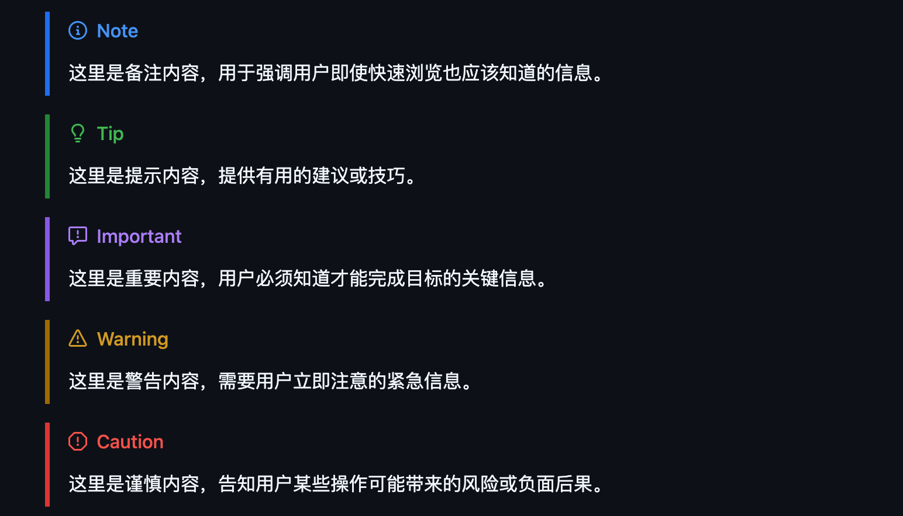

# Alerts 语法预研与实施规划

日期：2026-11-14。状态：首批呈现与编辑已实现，其余为后续规划。

当前交付：五类顶层 Alerts 的状态图标、英文标题、彩色左边线和同色系淡色底；统一 `alert.svg` 块入口；正文就地编辑、头部点击进入块源码、正文首位置 Backspace 保护；PDF 类型标题、状态图标与分页装饰。七语言默认指南已有示例，菜单名称本地化。

本次验证：Alerts 语法／会话专项通过；语法层 31 项、UI 63 项测试通过（UI 另有 1 项忽略）；真实窗口 Alerts 专项覆盖五类、两种主题布局、标题点击、正文编辑与撤销、源码模式及普通引用隔离；PDF 专项验证长正文跨页、标题仅出现一次且各页保留配色。架构检查、格式检查与 Clippy 通过，已更新 `target/Ryne.app` 并在独立窗口核对实际呈现。

全量回归未全绿：services 的 5 项语言自动识别／高亮测试、session 的 2 项自动高亮测试失败，services 单线程复跑仍失败；完整窗口冒烟停在 stage 37 的代码 Keyword 高亮检查。本次没有修改这些语言识别和高亮实现，Alerts 专项不以这些失败作为通过结果。

本次采用 `ryne-syntax` 的快照只读目录识别解析器确认的引用首行，未修改 `ryne-parser` 默认语义树或扩展开关。类型行原始换行保留为标题几何锚点，未往展示正文插入虚构标题文本。下面的解析器头部节点方案、类型切换／插入子菜单和标题本地化仍为后续计划。

建议首版支持 GitHub 文档列出的五种顶层 Alerts：NOTE、TIP、IMPORTANT、WARNING、CAUTION。Alert 是带类型标题的引用容器，正文继续使用 Ryne 的 Markdown 就地编辑；原始源码仍是唯一数据真相。颜色采用用户提供的浅色／深色 RGB，SEVERE 保留为后续 Ryne 扩展。

## 1. 外部规范与兼容范围

[GitHub 官方 Alerts 文档](https://docs.github.com/en/get-started/writing-on-github/getting-started-with-writing-and-formatting-on-github/basic-writing-and-formatting-syntax#alerts)明确列出五种类型，并说明 Alerts 不能嵌套在其他元素中。它是基于引用的扩展，不应因为名称含有 GFM，就改变仓库固定的 GFM 0.29 样例基线。

官方文档没有列出 SEVERE。因此，“GitHub 还有 SEVERE”不作为本项目的兼容性依据；用户给出的橙色可以保留为扩展色，但首版不把 `[!SEVERE]` 自动改写成 WARNING 或 CAUTION。

颜色表作为本需求指定的设计值固定使用，不宣称它们永远等于 GitHub 在线站点的最新主题 token。背景透明度、内边距和字体尺寸属于 Ryne 的视觉决策。

| 范围 | 首版建议 |
| --- | --- |
| 五类顶层 Alerts | 支持识别、呈现、编辑、菜单插入和 PDF 导出 |
| Alert 内的段落、列表、引用、代码、表格、图片、公式、Mermaid | 复用已有正文结构能力；代码保持字面内容 |
| 列表或引用内部的 Alert、Alert 内再嵌套 Alert | 首版按普通引用处理，保留类型标记可见；不影响原有嵌套引用能力 |
| SEVERE | 预留颜色与语义扩展位置，首版保留可编辑原文 |
| 自定义标题、折叠语法 `[!NOTE]+`／`[!NOTE]-`、任意类型名 | 首版不解释 |
| 普通引用 | 保持现有浅色背景、`quote_bubble.svg` 和 `quoter.svg` 规则 |

“顶层”指引用节点的语义父节点为 Document；Alert 内可以包含已有块结构，与“Alert 自身不能嵌套在其他元素内”是两回事。

## 2. 语法约定

标准输入如下；聊天消息中的展示转义反斜杠不属于模板内容。

```markdown
> [!NOTE]
> 即使快速浏览也应该知道的信息。

> [!TIP]
> 有用的建议或技巧。

> [!IMPORTANT]
> 完成目标所需的关键信息。

> [!WARNING]
> 需要立即注意的信息。

> [!CAUTION]
> 操作可能带来的风险或负面后果。
```

识别以解析器确认的引用节点和首个物理行为边界，不对全文做正则替换：

1. 类型标记必须位于引用第一行，去掉解析器确认的容器前缀后，该行只有 `[!TYPE]` 和可选的尾随 ASCII 空格／Tab。
2. 类型按 ASCII 大小写不敏感识别，插入模板使用大写；保存不修改用户原有大小写。此规则是 Ryne 的明确约定，也与当前 pulldown-cmark 后端行为一致。
3. 引用起始缩进、`>` 及其可选分隔空格由现有解析器判断。首版不额外吞掉容器前缀之后的正文缩进：`>[!NOTE]` 可作为标准变体；`>  [!NOTE]` 保守按普通引用处理。
4. 行尾必须是原始 LF／CRLF／CR 或 EOF。`> [!NOTE] 自定义标题` 不识别为 Alert，也不隐藏其中任何正文字符。
5. 标记只有在该引用开头生效。同一引用正文中的后续 `[!TIP]` 是普通文本；两个独立 Alerts 使用不带 `>` 的空行分隔。
6. `>` 空行仍在 Alert 容器内，可分隔正文段落。引用的终止范围和 lazy continuation 沿用解析器，不能按字符串遇到第一个非 `>` 行就截断。
7. 转义标记、实体拼出的标记、行内代码、围栏代码、缩进代码和 HTML 块内的示例不识别为 Alert。
8. 单独的完整类型行可以识别为语义草稿，但没有正文或可命中的空正文行时保持源码可见，不能变成无法放置光标的空面板。
9. 不完整、未知及不支持的形式保留原有引用呈现，类型文字继续可编辑；不自动补方括号、不猜类型。

例如多段正文使用同一个 Alert 容器：

```markdown
> [!IMPORTANT]
> 第一段，支持 **粗体**、`代码` 和链接。
>
> - 第一项
> - 第二项
>
> 最后一段。
```

## 3. 视觉设计

按用户提供的参考图采用左侧彩色竖线、独立状态图标与标题行、下方正文的结构。背景按用户后续要求使用对应状态色的淡色底，不采用透明底或普通引用灰底。浅色主题建议以强调色 6%、深色主题以强调色 10% 叠加各自纸张色，形成低饱和度、略亮于深色纸张的背景；透明度是待真实窗口校准的初始值，状态色来源仍固定使用下表。只给背景调淡，边线、标题和状态图标保持完整强调色。



参考图用于确认边线、状态图标、标题与正文的相对位置；背景以用户后续指定的同色系淡色底为准。图片像素不直接作为 GPUI 逻辑像素尺寸。

本轮读取的 [GitHub 官方站点样式表](https://github.githubassets.com/assets/global-747fc17113063fdc.css) 中，`.markdown-alert` 设置 8／16 px 间距、继承正文颜色和 `.25em` 左边线；五类分别设置边线与标题颜色，相关规则没有声明背景填色。标题与边线实际使用不同语义 token，本方案按用户指定统一使用表中强调色。该资源 URL 带内容哈希，只作为本次样式核实依据。

| 类型 | 中文标题 | 浅色强调色 | 深色强调色 | 内容区状态图标语义 |
| --- | --- | --- | --- | --- |
| NOTE | 备注 | `rgb(9, 105, 218)` / `#0969DA` | `rgb(47, 129, 247)` / `#2F81F7` | 圆圈信息 i |
| TIP | 提示 | `rgb(26, 127, 55)` / `#1A7F37` | `rgb(63, 185, 80)` / `#3FB950` | 灯泡 |
| IMPORTANT | 重要 | `rgb(130, 80, 223)` / `#8250DF` | `rgb(163, 113, 247)` / `#A371F7` | 带感叹号的消息框 |
| WARNING | 警告 | `rgb(154, 103, 0)` / `#9A6700` | `rgb(210, 153, 34)` / `#D29922` | 三角感叹号 |
| CAUTION | 谨慎 | `rgb(209, 36, 47)` / `#D1242F` | `rgb(248, 81, 73)` / `#F85149` | 八边形感叹号 |
| SEVERE，预留 | 严重 | `rgb(188, 76, 0)` / `#BC4C00` | `rgb(219, 109, 40)` / `#DB6D28` | 待扩展时设计 |

视觉参数以 100% 缩放时的 GPUI 逻辑像素计，实施后用真实窗口校准：

- 左边线 4 px，直角，无阴影和全包围边框；左右内边距 16 px，上下 8 px。
- 同色系淡色背景覆盖标题和全部正文区域，左边线贯穿完整块高；不要在普通引用灰底上再次叠色。长块跨越视口时按本帧块几何裁剪背景和边线。
- 状态标题沿用正文 18 px，半粗，行高至少 30 px；图标 18 px，图标与标题间距 8 px，标题与正文间距 8 px。
- 图标、标题与竖线使用相同强调色，正文沿用主题正文色；链接、代码和公式继续使用各自样式，不整块染色。
- 替换该容器原有的引用灰底与 `quoter.svg`；不把普通引用装饰重复画在 Alert 外层。内部普通引用保留结构缩进，首版不增加第二个外层菜单。
- 整块参与居中阅读栏和现有块间距。窄窗按实际剩余宽度布局，不能靠强制最小宽度挤出视口。
- 状态标题作为语义装饰生成，七语言本地化；源码 `[!NOTE]` 等类型值保持英文。语言、主题切换不修改源码、dirty 或历史。
- 图标使用仓库内嵌 SVG，与现有图标风格统一；不能用 emoji 字符代替。若直接引入 Octicons，需要随包保留相应许可。

块左上角外侧的类型入口统一使用现有 `assets/icons/alert.svg`，五类共用，替换该块原有的 `quote_bubble.svg`。入口沿用现有主题按钮色、hover／focus 显隐、拖选／IME／全文源码隐藏规则，垂直中心与状态标题行对齐，位置在彩色边线外侧，不占正文宽度。块菜单标题同样使用 `alert.svg`，与类型入口保持一致。

内容区标题前的状态图标按上表区分五类，并常驻于结构呈现中；它与块外侧的 `alert.svg` 菜单入口具有不同用途和点击区域，不能合并。前者点击进入类型源码，后者沿用现有块菜单交互。

## 4. 显隐与编辑交互

| 操作 | 预期行为 |
| --- | --- |
| 光标进入正文 | 保持竖线和标题；内部行内语法按各自规则展开 |
| 悬停标题或正文 | 不展开类型源码；块入口沿用现有 hover／focus 规则 |
| 点击状态标题／图标 | 打开该块局部源码，定位或选中类型值，便于修改 |
| 从正文第一位置向前导航 | 显示块源码并进入头部；不跳过无法访问的隐藏源码 |
| 正文第一位置 Backspace | 先展开局部源码且不删除字符，再按源码编辑规则处理，避免一次吞掉类型行 |
| 正文非空行 Enter | 延续引用前缀，不重复插入 `[!TYPE]` |
| 空引用行 Enter | 沿用现有引用退出一层的规则，保留 Alert 已有正文 |
| 正文 Shift+Enter | 沿用引用硬换行；列表、表格、代码内部优先使用自身命令 |
| 局部／全文源码模式 | 显示所有原始标记，去掉 Alert 装饰；换行保持字面行为 |
| 改成无效或未知类型 | 立即回到可编辑普通引用，保留全部字节 |
| 跨块拖选、替换和粘贴 | 统一源码选区，完整跨越 Alert 时包含隐藏类型行和前缀 |
| 复制块源码 | 包含类型行、正文前缀和原始换行；生成标题文字不进入剪贴板源码 |

手工输入 `> [!NOTE]` 时，在当前类型行仍有光标的情况下保留源码。按 Enter 后，复用引用续行写入换行和 `> `，光标进入空正文；此时才切换结构呈现。离开只有类型行的草稿时仍保留原文。不要在输入 `]` 时立即让当前编辑行消失。

识别状态属于解析结果；“类型行正在编辑／空草稿需要源码”属于临时呈现状态，两者分离。粘贴和打开完整 Alerts 正常识别，历史重放不重新触发输入补全。

IME 预编辑期间不识别临时类型、不切换头部显隐；确认后再解析，候选确认 Enter 不同时续行。拖选期间固定布局版本，结束后再评估显隐。任何纯模式切换均不增加撤销记录。

正文首尾边界、空正文和完整跨块删除必须有明确映射测试；不能依赖“隐藏区长度为零，所以自动跳过”来决定编辑行为。

## 5. 菜单与插入

末尾添加和块上方／下方添加入口增加“提示块”子菜单，包含五种状态，避免主菜单直接增加五行。插入模板为 `> [!TYPE]` 加原始换行、`> ` 和本地化占位正文，选中占位正文。沿用已有相邻块边界检查，不让未闭合容器吞入新块。

块类型菜单标题使用统一的 `alert.svg` 与当前类型的本地化名称，并提供“更改提示类型”子菜单；子菜单选项可以展示各自状态图标。切换类型只替换已验证标记中的类型字节，正文、缩进和换行不变，一次事务可撤销；同类型选择不产生历史。

首版不增加工具栏按钮、专用快捷键、任意块转 Alert、折叠功能或自定义颜色。局部源码入口保留，可直接修改类型或移除类型行，使其恢复普通引用。

## 6. 当前实现核实与后端探针

以下结论来自当前工作区代码，不把尚未实现的设计当作已有能力：

| 位置 | 已核实行为 | 对接影响 |
| --- | --- | --- |
| `ryne-parser/src/lib.rs::options` | 显式排除 `ENABLE_GFM`，保留 tables／strikethrough／tasklists | 不能修改默认开关破坏固定样例 |
| `ryne-parser/src/syntax.rs::tag_kind` | `Tag::BlockQuote(_)` 统一变成普通 `NodeKind::BlockQuote` | 单独打开后端开关会丢失类型身份 |
| `ryne-syntax/src/quote.rs` | 按解析器 ContainerPrefix 计算续行和退出范围 | 可复用普通引用编辑协议 |
| `ryne-features/src/presentation/quote.rs` | 生成引用范围、缩进，隐藏解析器拥有的 `>` | Alert 需增加类型头范围及不同装饰 |
| `presentation/legacy.rs` | 空展示范围不会生成 QuoteView | 空 Alert 正文不能依赖已有非空过滤 |
| `ryne-projection/src/lib.rs::QuoteView` | 只有范围、深度、缩进和空尾锚点 | 缺少类型、头部锚点和装饰标题描述 |
| `ryne-ui/src/text_layout.rs`、`paint.rs` | 外层引用只有一个面板，灰底和 `quoter.svg` | 需要状态头部的真实布局高度与命中 |
| `ryne-services/src/print_layout.rs` | 已有共享打印布局；普通引用没有 Alert 状态标题 | 导出必须显式消费新语义，不能隐藏标记后只剩正文 |

本轮在临时目录用本地 pulldown-cmark 0.13.6 编译产物运行了无窗口事件探针，打开 `ENABLE_GFM` 后结果如下。这些是后端行为，不代表 GitHub 在线渲染的边界承诺，也不是 Ryne 已实现结果。

| 探针 | 后端结果 |
| --- | --- |
| `> [!NOTE]` 后跟正文 | `BlockQuote(Some(Note))`；类型行不再作为 Text 输出 |
| 小写 `[!note]` | 同样识别 Note |
| `[!SEVERE]` | 普通引用，类型文字保留 |
| `[!NOTE] title` | 普通引用，类型和 title 保留 |
| 列表内 TIP、引用内 WARNING | 后端会识别嵌套类型，范围比官方文档更宽 |
| 同一引用中连续 NOTE／TIP，无块分隔 | 只有最前面的 NOTE 是类型，后面的 `[!TIP]` 是正文 |
| 只有 `[!NOTE]`，EOF | 有类型但没有正文 Text |
| 裸 CR 换行 | 可以识别 Note |
| 类型行后无 `>` 的 lazy 正文 | 后端仍可将正文放在 Alert 引用内 |
| `>  [!NOTE]` | 普通引用，类型文字保留 |

后端源码中的 `BlockQuoteKind`、`scan_blockquote_tag` 与 `ENABLE_GFM` 注释可用于差分参考：[pulldown-cmark 源码文档](https://docs.rs/pulldown-cmark/latest/src/pulldown_cmark/lib.rs.html)。实施验收以本仓库锁定的 0.13.6 源码为准，不跟随 latest 自动变动。

## 7. 推荐接入架构

### 7.1 解析层保留无损结构

推荐在自有解析器内增加可选 Alerts 识别，对已经确认的顶层 BlockQuote 首行作有界检查；当前默认 `options()` 不开启 `ENABLE_GFM`。这样能准确执行首版的顶层范围和保留源码策略，无需先让后端吞掉嵌套标记再补回。

继续保留 `NodeKind::BlockQuote` 作为容器身份，增加快照拥有的 Alert 描述，避免普通引用续行、容器前缀、列表嵌套等所有判断同时改成一套新容器类型。建议描述包含：

```text
AlertDescriptor
  owner                 引用节点 ID
  kind                  Note | Tip | Important | Warning | Caution
  source                完整引用源码范围
  header_line           类型行完整范围，明确包含哪些换行字节
  marker                [!TYPE] 的原始范围
  type_range            TYPE 的原始范围，供类型切换
  body_start            正文起始源码位置或空正文锚点
```

类型头从正文语义中分离，建立专用结构 token／头部角色，不能同时当作普通链接文字、引用式链接用户或正文样式处理。特别覆盖 `[!NOTE]: /url` 引用定义同时存在的情况：有效类型行优先是 Alert 头部，其他正文中的引用链接仍正常处理。

处理位置应在构建最终 lossless ledger、field origins、引用依赖和查询索引之前。若移除头部正文节点或拆分首个段落，须统一重映射节点 ID、parent／children 和引用 users；不能只删显示文本而保留悬空语义。类型行和正文同属一个 Paragraph、类型后是 SoftBreak／HardBreak 的情况需单独验证，不能从正文多删一个字符。

将解析配置收敛为能表达 dialect、math、alerts 的配置值，兼容原构造器语义。与 `docs/47_Inline_Highlight_Design.md` 的扩展开关规划合并设计，避免逐项增加布尔参数组合。裸 CR 语义视图、会话重解析、撤销／重做、排版语义验证和导出快照必须携带相同配置。

候选只遍历现有引用目录和第一物理行，不为每个 Alert 重解析全文；每次源码快照建立一次只读目录。保持现有依赖版本，不为五个状态引入新的 Markdown 解析器或 WebView。

### 7.2 语法查询与功能层

`ryne-syntax` 暴露 `alerts()`／按位置查询，返回快照绑定的只读描述；块查询增加 `BlockKind::Alert(kind)`，引用容器身份仍保留在底层 AST。局部源码、选择、复制、相邻插入按完整引用范围处理。

`ryne-features` 在现有主呈现贡献中接入 Alert，不注册第二个独占主呈现提供者，不依赖尚未完成的任意 Decoration 组合协议。类型切换和插入通过注册命令准备源码事务；UI 只消费声明式动作和元数据。

引用续行继续复用现有 Planner；新规则只负责类型行完成后的呈现状态与隐藏头部边界保护。表格、代码和列表的现有命令优先级保持不变。

### 7.3 展示与布局

可以在 QuoteView 中附加 Alert 语义描述，或新增由同一容器描述派生的 AlertView；首版倾向前者，避免维护两套引用范围。无论数据形式如何，以下要求不能省略：

- 头部为带源码锚点的布局元素，状态标题不是另一份可编辑正文；不向 `Display.text` 拼接本地化标题来冒充源码。
- 隐藏范围只覆盖已验证类型头和容器前缀；完整保留原始位置映射与空正文锚点。
- 标题高度、面板边界、正文宽度、点击区域、选择覆盖和 IME 几何进入同一布局帧，不在 paint 阶段临时加高度。
- 空正文仍可命中并输入；头部点击进入局部源码。只显示类型行而没有正文位置时采用草稿回退。
- 主题只改变颜色；语言、字体、缩放及标题尺寸变化参与布局缓存。光标闪烁不重新扫描引用或重建标题目录。
- 发布校验覆盖类型枚举、owner、源码范围、marker 与 header 包含关系、正文起点、展示范围和排序；异常整次走当前快照的可编辑源码回退，清理旧几何。
- 视口裁剪时，长 Alert 的边线按可见区域绘制，标题只在自身可见时绘制；不逐次 paint 遍历全文 Alerts。

`ryne-ui` 的状态强调色和淡色背景从 `Palette` 查询，背景按状态强调色与当前纸张色生成，SVG 显式设置颜色。`BlockKind::Alert` 的块入口和菜单标题元数据映射到 `alert.svg`，内容区状态图标独立映射。普通引用的灰底、图标和嵌套入口规则不受影响。

### 7.4 导出、排版与保存

PDF 使用冻结的 Alert 类型与标题语言，采用浅色强调色、打印正文色和同色系淡色背景；背景以白色打印纸张混合浅色强调色，不读取当前编辑器深色背景。状态标题必须保留；正文仍可选择，公式继续矢量导出，不能把整个 Alert 栅格化。块外侧的 `alert.svg` 是编辑控件，不进入导出。

长 Alert 允许跨页。标题与首个正文布局单元尽量同页；边线在每页正文片段延续，续页不重复标题。首正文为超高代码／表格时沿用既有拆分策略，不强制整块同页导致溢出或空页循环。通过共享 `print_layout.rs` 表达语义，PDF 编码器不重新识别 `[!TYPE]`。

自有 HTML 输出若使用开启 Alerts 的解析配置，显式渲染类型标题和容器 class；默认固定 GFM 输出保持原行为。HTML 转义沿用现有策略，不引入原始 HTML 执行。

“排版”按相同解析配置比较 Alert 类型、容器和正文语义，不合并相邻 Alerts、不把类型头当普通链接改写。保存继续直接保存原始源码；纯显隐和主题变化不产生字节修改。

## 8. 实施顺序与完成标准

| 阶段 | 工作 | 通过条件 |
| --- | --- | --- |
| A 语义与范围 | 可选配置、五类识别、头部 token、只读目录、默认基线 | 固定 GFM 样例不变；Alerts 无损往返；嵌套／未知类型保留原文；LF／CRLF／CR 一致 |
| B 投影与视觉 | 标记隐藏、空正文锚点、标题布局、五套主题色和图标 | 五类亮／暗主题可读；正文可编辑；普通引用不变；新旧帧校验有效 |
| C 编辑与菜单 | 输入完成策略、边界导航／删除、类型菜单、插入模板、七语言 | 一次源码动作一次撤销；IME 不重复换行；跨块选区不丢头部；源码模式完整可编辑 |
| D 导出与交付 | PDF 标题／分页、排版语义、欢迎指南、README 和状态说明 | 导出不丢类型；保存字节稳定；回归和真实窗口冒烟通过 |

主要风险依次是隐藏头部与正文边界映射、额外标题行的统一几何、头部从原段落语义中分离、跨页打印。配色和图标实现本身风险较低。各阶段串行建立正确性，不先交付只有彩色截图但无法编辑的面板。

## 9. 验收矩阵

| 类别 | 必须覆盖 |
| --- | --- |
| 语法 | 五类、大小写、EOF、首行位置、尾随空格、额外前置空格、同一行尾随标题、未知类型、SEVERE、转义、引用定义冲突 |
| 块边界 | 两个有空行分隔的 Alerts、无分隔的两个类型标记、正文空引用行、多段正文、lazy continuation、相邻列表和标题 |
| 容器 | Alert 内列表／嵌套引用／代码／表格；列表和引用中的类型标记保持普通引用 |
| 字面内容 | 代码块、行内代码、HTML 内的 `[!NOTE]` 不识别；源码模式不补全结构 |
| 编辑 | 首正文位置 Backspace、前向删除、头部左右／上下导航、删除类型行、类型切换、正文清空、粘贴、跨块替换、撤销／重做 |
| Unicode 与换行 | 中文、组合字符、emoji、UTF-16 IME 范围、LF／CRLF／CR、末尾无换行 |
| 显隐 | 正文焦点不拆结构；hover 不展开；局部／全文源码；IME 和拖选冻结；无 dirty／历史变化 |
| 视觉 | 五类亮／暗主题的同色系淡色底、统一 `alert.svg` 块入口与五类内容图标的独立命中、缩放、窄窗、长正文、首正文为表格／代码／图表、空正文命中、背景与边线视口裁剪 |
| 导出 | 标题保留、正文可选择、代码／表格跨页、公式／图像、超高首正文不循环分页、切主题不改变打印色 |
| 生命周期 | 旧快照菜单不能改新文档；切语言不改源码；投影失败回退；新增目录不在光标闪烁时重复扫描 |

实现后按改动范围执行架构检查、格式检查、相关测试和完整回归，再执行 clippy 与真实窗口 smoke；专项 smoke 需以错误结果退出，不让 panic 穿过 AppKit。macOS／Windows 的人工输入法与鼠标验收单独记录，不能用自动冒烟替代。

初次预研新增此设计文档并运行上述临时后端探针。后续已在七语言默认指南加入五类语法示例，并按用户参考图补充统一 `alert.svg` 块入口与同色系淡色背景要求，参考图保存在 `docs/assets/alerts-style-reference.png`。首批产品实现及验证结果见文首交付范围；完整计划中的未交付项仍保持规划状态。
